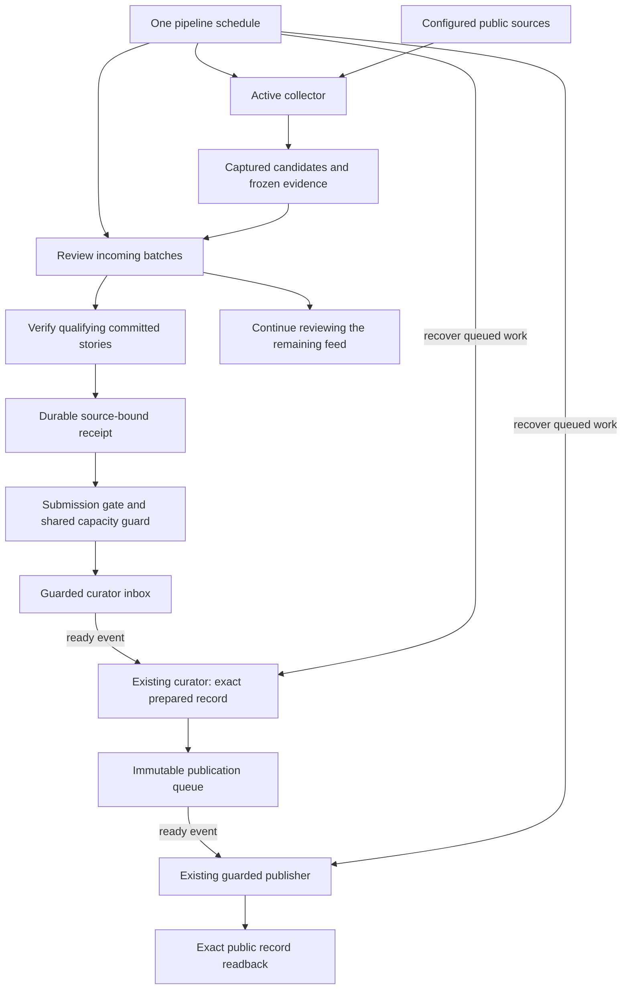
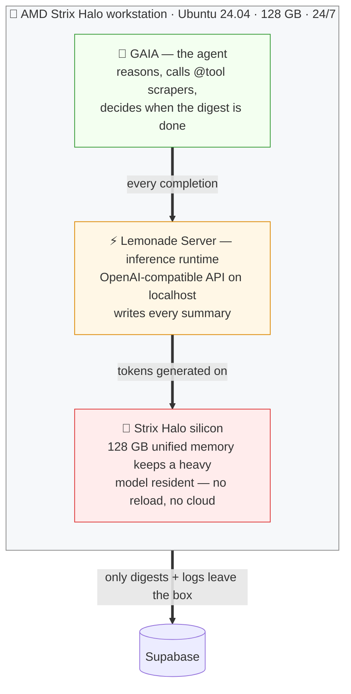
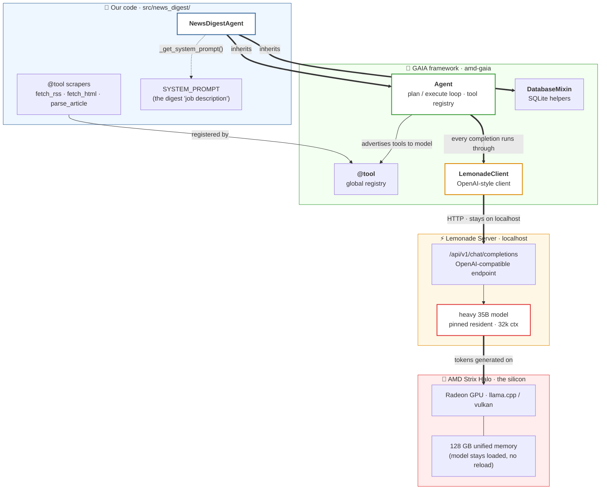
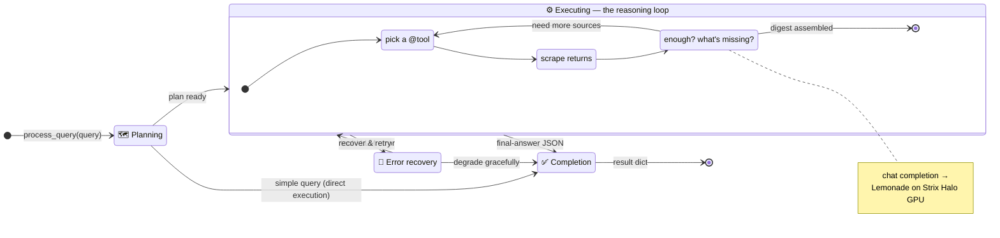
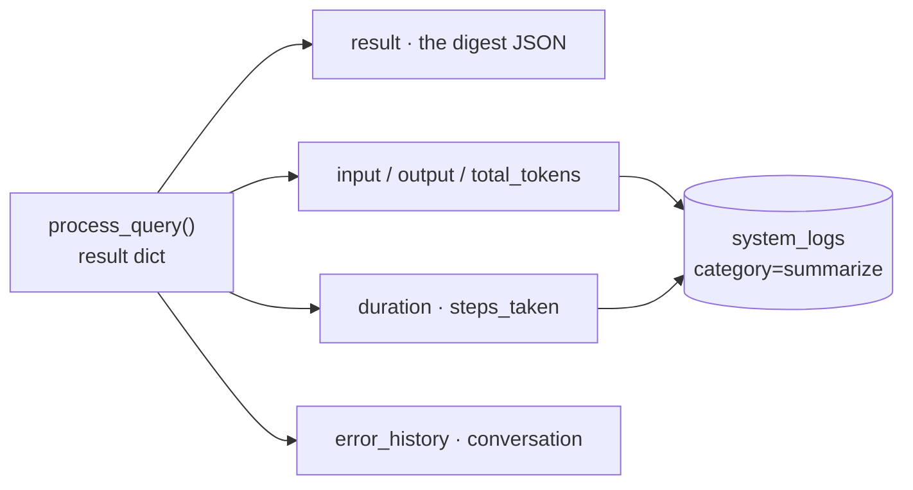
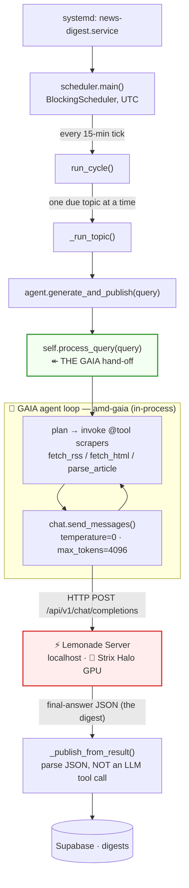
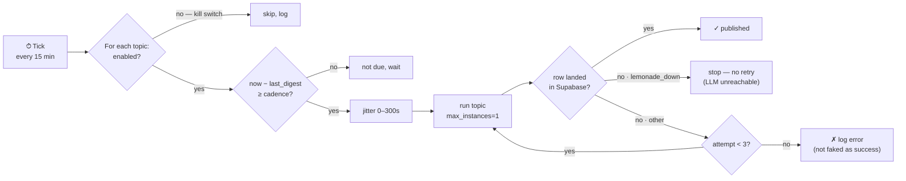
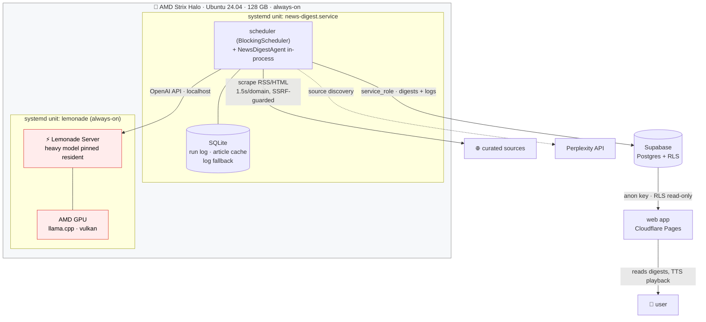
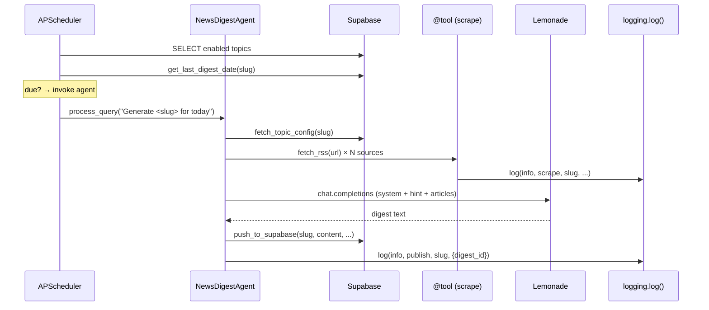

# News Digest Agent — Architecture

This document is the central current reference for the repository: the
**Warp Core** news-collection and guarded-Bluesky publishing pipeline that
runs on the existing Supabase project. The *earlier* GAIA/Lemonade
local-inference digest design is retained below as an appendix (reference
only); its Python implementation has been removed from the repository. The
appendix's `§n` section numbers are preserved verbatim because tracked code
and migrations cite them (e.g. `§3.1`, `§7.1`, `§7.2`). Do not use the
appendix's scheduler/systemd deployment instructions to infer which Warp Core
workers are active.

Companion documents:
- [`AGENTS.md`](../AGENTS.md) — agent tool-use guidance (focused on *how* to work in this repo, not the system design)
- [`README.md`](../README.md) — user-facing overview, setup, operations
- Operational inventory, stop and recovery: [`warpcore-recovery.md`](warpcore-recovery.md)

---

## Warp Core architecture and operational status

Warp Core collects public news into the existing Supabase News Digest project and publishes through a guarded Bluesky queue. The Gemma-backed autonomous agent is the enabled editorial producer, and its first ordinary post and native repost have been published through the existing guarded sender. The owner explicitly approved shipping. The old Dot task is off according to the owner; that task's retirement was not independently verified through a schedule-control tool.

This is the central current reference for Warp Core. The checkpoint below is an operator-reported deployment snapshot, not an automatically refreshed status page. Confirm live versions and flags before changing a deployment. Older documents retain useful contracts and evidence, but their deployment statements describe their recorded dates.

### Dated deployment checkpoint (November 17–19, 2026)

The following versions and counts are historical evidence only. The [November 21 deployment readback](evidence/2026-11-21-deployment-readback.md) separately records agent v34, curator v8 and publisher v14, exact retrieved artifact hashes, selected SQL/grant comparisons and public-record readbacks at approximately 21:52 UTC. That bounded audit does not establish complete schema parity, the collector roster, current schedules or reliability-extension installation. The tracked roster contains **55 sources**; the recorded hosted **43** is not a current live count. The [November 21 source inventory](evidence/2026-11-21-source-inventory.md) leaves deployed source configuration and per-source freshness unknown. Use the [inventory and recovery procedure](warpcore-recovery.md) before operational changes.

| Area | Recorded state |
|---|---|
| Collector | 43 configured public sources, checked by the single 30-minute pipeline schedule |
| Source acquisition health | Earlier recorded two-hour window: all 43 sources attempted; 37 historical gaps, five partial traversals and one Perplexity HTTP 403 failure; these are distinct outcomes, not 43 collection outages |
| Curation drain | Version 6, dispatched when an agent inbox row arrives, with single-tick recovery as the receipt-aware database drain; retained legacy inbox work is not deleted |
| Publisher | Version 12, dispatched when an approved record is prepared, with single-tick recovery with its existing account, queue and guards |
| Autonomous producer | `news-agent` version 23, using Gemma 4 26B / PrimeIntellect and verification V8, with a 60-second model deadline and 180-second lease; producer, verification, submission and 30-minute pipeline schedule enabled. Reviewed shared-pool 429 continuation is installed; generic unknown failures still require owner recovery |
| Retained discovery evidence | Two Together discovery cycles completed 650/650 and 651/651 assessments for 0.06916930 and 0.06925995 credits. A cloud-scheduled Cerebras cycle also completed 652/652 for 0.17891190 credits. Earlier unknown holds remain preserved; full coverage does not establish editorial quality |
| Earlier Gemma discovery cycle | Run `755c7c94-ca0b-4e58-8d71-c98e46bcf6f7` failed on timeout after 64/654 assessments, revision 18; 0.0060952 spent and 0.036045 unknown held. Owner-CAS workflow quarantine advanced it to revision 19, deferred/blocked, without releasing money. No complete Gemma scan is claimed |
| Active model contract | `google/gemma-4-26b-a4b-it`, pinned `primeintellect/bf16`, discovery profile `2026-11-17.8`, no provider fallback, ZDR and reasoning `none`; 4096 output tokens and a 0.036045-credit reservation. Future active selection is restricted to GPT-oss or Gemma; NVIDIA/Meta history remains retained for accounting |
| Verification and admission | Receipt, verification-job and shared five-item guards installed; verification, backfill and submission enabled. `exclusive_agent=true` fences new Dot submissions; existing jobs, queues and financial history remain intact |
| First published results | Publisher request 842 returned HTTP 200 with two processed records, both `published`: a 240-character GLM post and a Verano native repost. Exact ordinary AppView/UI and native public-PDS readback evidence is recorded in the [cutover report](evidence/2026-11-17-scheduled-discovery-quality.md#gemma-cutover-and-first-publications) |
| Legacy Dot schedule | Owner-confirmed off; exact legacy automation control was unavailable to this operator. This is distinct from the still-needed curation drain |
| Spending policy | Private ledger and existing prepaid OpenRouter credits; daily and lifetime application caps removed by owner request. nullable policy limits mean uncapped policy; effective budget-row reproducibility still needs verification (see the recovery reference); cost records and per-request validation remain |
| Exception alerts | Dashboard backend enabled by the operator; authenticated RPC verified. Signed-in frontend delivery remains unverified; no owner channel selection is claimed |
| Public owner feedback | SQL and full runtime deployed, disabled. Halo public-API check returned an explicit empty-feed coverage gap |

Earlier incomplete discovery and unknown-billing attempts remain preserved in the audit ledger. The current keyed schema requires every supplied candidate ID before ranking. A later unbilled follow-on scan was explicitly cancelled with its captured candidates retained; it was not relabeled as completed. See the [scheduled discovery and quality checkpoint](evidence/2026-11-17-scheduled-discovery-quality.md).

These are OpenRouter credit limits and measured credit charges, not a claim of free inference or a currency conversion. No additional paid service is introduced. Keys remain private in server configuration or Vault and are not stored in GitHub.

### What runs where

| System | Responsibility |
|---|---|
| Supabase Edge Functions | Existing public-source collection, curator processing and publishing; autonomous discovery and verification |
| PostgreSQL, pg_cron, pg_net and Vault | Durable evidence and queues, leases, budgets, authenticated scheduled requests and private server credentials |
| OpenRouter, explicit reviewed model/provider registry | Bounded model judgments about discovery and evidence, with explicit provider/privacy/price controls and no fallback |
| Strix Halo | Disposable PostgreSQL/PostgREST/Deno tests and bounded model checks; it is not a production dependency of the Supabase pipeline |
| GAIA and Lemonade | Earlier Python/local-inference digest path (implementation removed; design retained in the appendix); not the active Warp Core publishing runtime |
| Web reader and TTS | Separate digest-reading application; this producer transition does not change its authentication, playback or deployment |

The reader is documented in [web/README.md](../web/README.md). The older [GAIA/Lemonade architecture](#appendix-earlier-gaialemonade-design-reference-only) is retained in the appendix of this document; its scheduler and systemd deployment instructions should not be used to infer which Warp Core workers are active.

### News flow and authority



The agent is the sole enabled new editorial producer at this checkpoint. Owner-reported Dot task retirement and the database exclusivity fence are separate controls. A ranking proposal is not verified news, a verification receipt is not a publication, and an inbox ID is not public-readback evidence.

1. **Collection:** the configured roster supplies public discovery material. Each source has durable attempt/checkpoint state. A fresh successful retrieval can still have a historical coverage gap; a `gap` is not automatically an outage or proof of complete upstream history. See [source acquisition checkpoints](warpcore-source-checkpoints.md).
2. **Discovery:** the durable waiting list contains new, eligible stories without a committed assessment. The worker takes at most 16 items directly into review; committed skips and qualifying decisions remove those items from future batches. Unfinished work resumes before another batch is allocated. Qualifying committed decisions can enter verification before the full review finishes. One early verification per committed batch interleaves with continued review, so posting and coverage both make progress. Completion validates full coverage and records counts; it performs no global sort or new final-shortlist writes. There is no separate five-stories-per-parent-run ceiling; the shared pending queue remains bounded to five; hourly authentication/publication attempt quotas were removed by migration `20261118180116_warpcore_drain_without_hourly_quota.sql`.
3. **Verification:** exact captured URLs or a fixed public Bluesky API route provide bounded public evidence. DNS/IP-pinned TLS retrieval rejects private destinations and redirects. Source text and model output remain untrusted. Trusted code binds hashes, exact quotations, original identities and dates; whether a quotation supports a natural-language claim remains an explicitly recorded model judgment.
4. **Preview and receipt:** current evidence and complete publication/pending-work history bind a durable receipt. Verification can finish while submission remains disabled for owner review. Stale evidence, changed history or expired receipts prevent transfer.
5. **Admission and curation:** a distinct agent identity enters the existing guarded inbox only through the submission gate. It does not impersonate a Dot. The shared admission boundary keeps combined pending editorial/publication work within five distinct stories, including legacy writers. The curator reconstructs and checks the exact frozen packet and publication job.
6. **Publication:** the publisher uses the stored account, collection, immutable TID record key and payload. It records an atomic attempt before a write; the later drain migration retains counters without an hourly quota. Unknown outcomes remain recorded. For native reposts, `verifySubject` re-fetches the public original and checks its URI, CID and author immediately before writing. A write receipt alone is insufficient: reconciliation reads back the exact record and URI. Mismatch or uncertainty requires reconciliation, never automatic re-keying or a blind repeat write.

Original summaries use non-Bluesky primary evidence and retain attribution. Captured Bluesky originals can produce only a native repost of the exact subject, preserving the original author. The native verification path does not authorize copied summaries of those posts. See [native repost contracts and dated deployment evidence](warpcore-native-reposts.md).

### Gates, spending and operational visibility

The database producer setting, cron active flag, verification setting and submission setting are separate controls. Keeping verification or submission off must not require disabling the existing collector or publisher.

The hosted bootstrap uses the existing Supabase project URL and trusted server service-role key. With no legacy `WARPCORE_AGENT_CRON_TOKEN` environment setting, the protected database producer gate defaults off. Service-only fixed RPCs supply private authorization/runtime values to server code; the dedicated trigger token is checked before model-key lookup and work. Existing environment-token installations retain their explicit environment gate. Platform JWT verification remains required. The request body cannot choose a model, budget, source, destination or run.

The service role is trusted server infrastructure, not a model worker. Managed Supabase already gives it Vault privileges. Private tables and administrative helpers retain their own grants; anonymous/authenticated callers and the model receive neither credentials nor arbitrary SQL authority. See [producer implementation details](warpcore-agent-producer.md) for the fixed RPC and scheduler contracts.

Every paid request requires a pre-existing ledger reservation and a recorded dispatch. Known usage settles before content validation; an invalid completion does not erase its cost. Unknown usage retains a conservative hold and prevents automatic paid replay. Daily provisioning respects lifetime headroom and never raises or resets an existing budget. The active Gemma row retains a 16-candidate discovery batch, 4096 output tokens and its model-specific reservation. GPT-oss/Cerebras remains an allowed alternative with its existing limits; retired NVIDIA/Meta profiles remain accounting history, not future active selections. The producer is enabled. Exact Gemma/PrimeIntellect shared-pool 429 failures can be audited and excluded from future work after at least five minutes beyond lease expiry, respecting longer Retry-After and a ten-per-UTC-day bound; their unknown reservations remain held and failed requests cannot replay. Generic unknown failures still stop verification for owner recovery. Optional fenced release of a successfully committed lease lets the next invocation continue promptly without changing coverage or paid-attempt history.

`warpcore_agent_health()` exposes safe operational aggregates. Source health should be compared against the exact deployed configured key set (55 tracked; 43 in dated hosted evidence) using `warpcore_source_sync_health`; the older digest reader's source-health view is a separate dataset. Report recent attempts, partial progress, historical gaps and failures separately.

Prepared dashboard alerts emit fixed exception codes and aggregate counts, with transition deduplication and optional resolution messages. They distinguish actual stalled progress from lease renewal, recent historical gaps from source-attempt outages, and an owner-waiting preview from an enabled but stalled handoff. This is a delivery option, not an owner-approved alert destination. Enabling it or replacing a cron command is an explicit operational change; installation alone performs neither.

### Public owner feedback

The prepared feedback path reads a fixed public author-feed endpoint for the pinned owner DID and verifies replies to Warp Core's public post identities. It records bounded, inert feedback for operator review. It cannot edit editorial policy, spending, credentials or schedules, initiate a Dot chat, read private messages or answer publicly. The Halo empty-feed result is a coverage gap, not proof of complete historical feedback retrieval. See [public owner feedback](warpcore-owner-feedback.md) for its identity, pagination and review boundaries.

### Cutover and continuing validation

The owner explicitly said “Ship it” for the Gemma rollout. Producer, verification, submission, exclusivity and the minute continuation cron were enabled. Publisher request 842 processed two records and reported both published. The GLM ordinary post has public AppView and read-only UI confirmation; the native repost has authoritative public PDS readback of its exact URI, CID and original subject. See the [publication evidence](evidence/2026-11-17-scheduled-discovery-quality.md#gemma-cutover-and-first-publications).

This is a recorded cutover and first-publication result, not a numeric editorial-quality score or proof of sustained unattended reliability. The earlier [editorial review packet](evidence/2026-11-17-editorial-review.md) remains historical: its held llama.cpp preview must not be submitted, and earlier model/source failures are not relabeled as passes. Shipping the current Gemma results does not approve those held records.

Continue observing full discovery coverage, source retrieval and quote support, duplicate handling, actual rendered text and native attribution, spending/holds, overlap and uncertain-write reconciliation. A model judgment is not a deterministic entailment proof. GitHub V6-and-later release-body/date quote roles are enforced in trusted canonical runtime code; SQL still proves raw hashes, spans, source identity and date bindings.

Use exact deployed targets and read back flags before further operational changes. Keep collector, curation drain and collection-aware publisher available. Do not confuse an owner-confirmed disabled Dot task with a tool-verified automation retirement, or the exclusivity fence with stopping Dot reasoning costs.

The reviewed timeout and exact shared-pool 429 workflow controls are installed. The failed 64/654 discovery cycle remains incomplete: an explicit owner-CAS quarantine moved revision 18 to 19, deferred/blocked, preserving its unknown hold. One eligible verification 429 was advanced. Readback found zero blocking discovery runs and zero unquarantined uncertain verifier jobs, and producer, verification, submission and minute cron were restored. All eight unknown attempts and the whole budget were exactly unchanged: 0.625054 held and 0.6044672 spent credits. This releases workflow fences, not billing uncertainty or failed-request replay. Generic unknown failures still require owner recovery; the discovery timeout helper is private and manual. Neither enabled scheduling nor two publications establishes full Gemma coverage or sustained reliability. Source capture remains full or deferred, never truncated: Gemma's aggregate bound is 200000 bytes, GPT-oss/Cerebras 120000, and each GitHub release API capture at most 100000. These byte bounds do not guarantee a provider token-context fit.

Every new record remains subject to public-source/native identity, freshness, complete-history deduplication, attribution, shared pending capacity and the hard 300-grapheme/3000-byte publication checks. Minor prose imperfections accepted by the owner do not bypass these deterministic guards. No new per-story owner approval screen is introduced.

### Stop and recovery

The `2026-11-21.1` full-history editorial policy requires the matching worker and `20261121215230_warpcore_full_history_editorial_policy.sql` migration. For rollout, pause the producer and drain discovery work and active leases first; the migration rejects an active producer or unfinished work and leaves the producer paused. Apply the migration, deploy the matching worker, verify policy agreement, then restore the intended gates. This repository change does not apply the migration or deploy production.

Follow the [state-preserving stop, inventory and recovery procedure](warpcore-recovery.md). It distinguishes new dispatch from in-flight work, retains uncertain outcomes and financial evidence, and requires collection-aware reconciliation before resumption. This procedure has not been exercised in production by this change.

### Evidence and further references

- [November 21 verification correctness reconciliation](evidence/2026-11-21-verification-correctness.md): full-history policy and native-original corrections, local acceptance limits and guarded rollout requirements.
- [November 21 guarded-publication contracts](evidence/2026-11-21-guarded-publication-contracts.md): disposable PostgreSQL/PostgREST contention, lease and recovery evidence; no production mutation or live send.

- [Editorial policy](../supabase/functions/news-agent/policy.mjs): current scope, verification, attribution, full coverage and native-repost rules.
- [Ranking acceptance checkpoint, November 16](evidence/2026-11-16-ranking-acceptance.md): 405-candidate synthetic ordering/restart checks and their limitations.
- [Paid pilot receipt, November 16](evidence/2026-11-16-strix-halo-paid/result.json): recorded model/provider costs and development-label agreement; not held-out or live publication acceptance.
- [Hosted spike history](warpcore-hosted-spike.md): dated environment attempts and test boundaries, not the current deployment map.
- [Full-review contract](warpcore-full-review.md), [shared publication budgets](warpcore-hourly-batches.md) and [source directory](warpcore-sources.md): detailed existing operational contracts; recheck dated deployment statements against the checkpoint above.
- [Reader documentation](../web/README.md) and the [earlier local digest architecture](#appendix-earlier-gaialemonade-design-reference-only) appendix: separate reading/local-inference paths.

### Discovery timeout follow-up

Repeated 30-second Gemma discovery timeouts were an operational defect, not an editorial-quality failure. The follow-up raises the bounded model deadline to 60 seconds with a 180-second lease and adds narrowly scoped automatic quarantine for exact recorded Gemma discovery timeouts and strictly identified PrimeIntellect shared-pool 429s after lease expiry plus five minutes, capped at ten combined recoveries per UTC day; a longer bounded Retry-After is respected. Full unknown holds and failed coverage remain recorded, and old workflows cannot replay. Later scans use the normal UTC-hour slots. See the [bounded timeout recovery evidence](evidence/2026-11-17-gemma-timeout-recovery.md). Source/history deadlines and publication guards remain intact.

At the earlier checkpoint the receipt-aware curation drain ran every minute (same existing job and v6 code), because the earlier hourly wait allowed three guarded receipts to become stale. Those three inbox records were safely rejected and retained, not counted as publications. That earlier checkpoint is superseded by the rolling event-driven handoff below; account and send guards remain.

### Rolling publication

The owner replaced the batch-first publication requirement with find, verify and publish. Up to ten existing capture pages run in one bounded invocation; larger scans still resume with their keyset cursor. Already committed eligible decisions can be verified while remaining candidates continue through review. A full queue yields to background review instead of paying for more verification.

One recurring pipeline tick replaces the separate collector, agent, curator and publisher schedules. Durable inbox/approval events dispatch the next existing worker immediately, and the tick recovers queued work. The guarded publisher reads its actual pending queue before reserving a login. Empty checks use no login attempt. At that earlier checkpoint authentication and publication had hourly quotas. Migration `20261118180116_warpcore_drain_without_hourly_quota.sql` subsequently removed both quotas, preserving counters, immutable records, pinned identity and uncertain-write readback. The shared five-item pending-work guard is a separate admission limit. No session cache or new credential store is introduced.

Historical ranking rows are retained; the obsolete end-of-scan sort and shortlist creation are removed. Published stories qualify as they are reviewed rather than competing for a final best-five batch. Every candidate still receives review, and source, history, freshness, duplicate, factual-attribution and spending gates remain in force. Collection runs every 30 minutes; publication follows qualification rather than waiting for another fixed-hour batch.

#### One schedule and immediate handoff

The single private pipeline tick checks sources every 30 minutes and recovers durable curator/publication queues. Collection completion records readiness and wakes the item worker immediately. The same tick also wakes the worker to recover saved items even if collection fails; newly arriving items remain available for its next batch. Each worker invocation advances up to 12 steps, starting another step only before 10 seconds have elapsed, leaving room for source fetching and the existing model deadline; the existing per-call deadlines, leases and spending limits remain in force. Work left over stays in the database for the next tick. Agent inbox rows dispatch the curator after commit; approved prepared records dispatch the publisher after commit. Fixed routes, existing Vault authentication, private helpers and minute/half-hour coalescing keep this dispatch narrow. Failed enqueue does not roll back a valid queue record; the next tick retries the existing guarded path. The old four stage schedules are removed at cutover.

### Fresh-start cutoff

At the owner's request, unpublished backlog is cleared and the existing single pipeline runs every 30 minutes. The private `first_seen_since` cutoff admits only canonical stories first collected after that reset. Refreshing evidence does not change a story's original collection time. Matching the verification cohort cutoff prevents old completed or quarantined discovery work from feeding the new queue. Previously published records, source history, model costs and unresolved holds remain intact.

Collection responses distinguish fetched feed entries, newly collected items and duplicate entries, and report whether processing was queued or deferred. The private queue summary reports waiting, reviewed, skipped, qualified, verification and publication counts since the fresh-start cutoff, plus the oldest waiting item. These measures describe different stages; fetched entries are not new stories.

---

# Appendix — earlier GAIA/Lemonade design (reference only)

This appendix is the canonical design reference for the *earlier*
GAIA/Lemonade implementation. Its Python implementation has been removed
from the repository; this appendix retains the design record only, and the
source-file links below point at that removed tree. Every legacy
implementation issue links to a section here (`§n`). When legacy behavior
diverges from this appendix, update the section in the same PR. The `§n`
numbers below are preserved verbatim for in-repo code references.

---

## §1 System overview

The News Digest Agent is a single-user, audio-first news aggregator. It runs 24/7 on an AMD Strix Halo workstation (Ubuntu 24.04, 128 GB RAM). A scheduled agent scrapes curated sources, summarizes them with a local LLM (Lemonade Server), and publishes digests to Supabase. The user consumes digests via a mobile web app that reads them aloud with the browser's Web Speech API.

Design invariants:

1. **The LLM is the summarizer.** No separate summarization module. Output quality is tuned through prompts, not code.
2. **Tools are pure functions.** Each `@tool` performs one narrow operation. The agent's reasoning orchestrates them.
3. **Config is data.** Topic definitions live in Supabase, not source.
4. **Local first, cloud for storage.** Inference is local; only digests and logs traverse the network.
5. **Single user.** No multi-tenant concerns. Auth is one email allowlist.

```
                      ┌───────────────────────────────────┐
                      │     NewsDigestAgent(Agent,         │
                      │                  DatabaseMixin)    │
                      │                                    │
┌─────────────┐       │  ┌──────────┐   ┌──────────────┐  │       ┌──────────┐
│  Web Sources │──────▶│  │ @tool    │──▶│ Lemonade     │  │──────▶│ Supabase │
│  (RSS, HTML) │       │  │ scrapers │   │ Server (LLM) │  │       │ (REST)   │
└─────────────┘       │  └──────────┘   └──────────────┘  │       └──────────┘
                      │        │                           │
                      │        ▼                           │
                      │  ┌──────────────┐                  │
                      │  │ DatabaseMixin │                  │
                      │  │ (SQLite)      │                  │
                      │  └──────────────┘                  │
                      └───────────────────────────────────┘
                                   ▲
                                   │
                      ┌────────────────────┐
                      │ APScheduler + systemd│
                      └────────────────────┘
```

---

## §1.5 The local-first stack: GAIA + Lemonade + Strix Halo

Everything that reasons about your news runs on one AMD workstation under your
desk. No inference request, no article text, and no prompt ever leaves the
machine. The only thing that crosses the network is the finished digest on its
way to storage — and the logs that say it happened.

That's not an accident of deployment; it's the whole point. Three layers make it
work:

- 🧠 **GAIA** — *the agent framework.* A GAIA `Agent` reasons over a topic, calls
  `@tool` scrapers, reads what comes back, and decides when the digest is done.
- ⚡ **Lemonade** — *the inference runtime.* GAIA talks to Lemonade Server over a
  standard OpenAI-compatible API on `localhost`; it serves the models that write
  every digest and power source curation.
- 🔴 **Strix Halo** — *the silicon.* 128 GB unified memory lets a heavy model stay
  resident across runs — no reload, no cloud.



**What this buys you:** your reading habits and source list never become someone
else's training data or telemetry; there's no per-token bill and no rate limit;
and the round trip is a loopback call, not an internet hop. The cloud's only job
is to hold the output — `digests` and `system_logs` in Supabase — so you can read
the result from your phone.

> Measured throughput — model id, tokens/sec, and per-digest wall-clock on this
> host — belongs here once captured from a real run.
> *(placeholder: run `python -m news_digest "…"` and record the actual numbers
> rather than estimating.)*

### Two model tiers, three jobs

Lemonade serves two locally-resident model tiers, picked per task. Everything
below runs on the Strix Halo GPU — no LLM call leaves the box.

| Activity | Model tier | Config key | Where |
|---|---|---|---|
| **Generate the digest** — the reasoning loop *is* the summarizer (invariant #1) | heavy | `lemonade_heavy_model` | [agent.py](../src/news_digest/agent.py) |
| **Curator: craft the web-search query** — turns a failing source + topic into a Perplexity query | light | `lemonade_light_model` | [`craft_query`](../src/news_digest/curator.py) |
| **Curator: judge candidate relevance** — scores a discovered source against the topic (drives auto-adopt / queue / reject) | light | `lemonade_light_model` | [`judge_relevance`](../src/news_digest/curator.py) |

The **heavy** model does the daily work — generating digests. The two **light**
model calls fire only when the source curator is repairing a persistently-failing
source, and fall back to the heavy model if no light model is configured
([curator.py](../src/news_digest/curator.py)). Article deduplication
(`deduplicate_articles`) is a pure function — **no model involved**.

---

## §1.6 🧠 Meet GAIA — the framework doing the thinking

**GAIA is [AMD's open-source, local-first agent framework](https://github.com/amd/gaia).**
It gives us the hard parts of an LLM agent — a planning loop, a tool registry,
conversation/token accounting, and a client for local inference — so the app
only has to supply *tools* and a *prompt*. We **build on GAIA, we don't fork it**:
a pinned-revision [capability audit](gaia-audit.md) confirmed every primitive we
rely on, with machine-checkable contract tests guarding the pin.

### GAIA at a glance — the four primitives we compose

| Primitive | What GAIA gives us | Where we use it |
|---|---|---|
| 🤖 **`Agent`** | The plan → act → reason loop, tool dispatch, and `process_query()` entry point | base class of [`NewsDigestAgent`](../src/news_digest/agent.py) |
| 🔧 **`@tool`** | A decorator that registers a plain function into a global tool registry the model can call | [`fetch_rss` · `fetch_html` · `parse_article`](../src/news_digest/tools/scraping.py) |
| 💾 **`DatabaseMixin`** | Drop-in SQLite helpers (`init_db`, `query`, `insert`…) for local state | mixed into the agent, [`init_db`](../src/news_digest/agent.py) |
| ⚡ **`LemonadeClient`** | An OpenAI-style client for the **local** Lemonade runtime | model + context management, [`load_model`](../src/news_digest/agent.py) |

### How the pieces compose — GAIA → Lemonade → Strix Halo

Our code is small; GAIA is the engine underneath it, and the engine runs the
model locally on AMD silicon. The same picture, top to bottom, is the whole
local-inference story.



### Inside one `process_query()` — GAIA's agent loop

When we hand GAIA a topic, it runs its own **planner state machine**
([audit §1.2](gaia-audit.md)): `STATE_PLANNING` → `STATE_EXECUTING_PLAN` /
`STATE_DIRECT_EXECUTION` → `STATE_COMPLETION`, with `STATE_ERROR_RECOVERY` as the
safety net. The model decides which tools to call and when the digest is finished
— that reasoning *is* the summarizer (design invariant #1). Every "reason" step
is a chat completion served by **Lemonade on the Strix Halo GPU**.



### What GAIA hands back — built-in observability

`process_query()` doesn't just return text — it returns a result dict GAIA
assembled with **per-run accounting we log on every digest**
([agent.py](../src/news_digest/agent.py), the `summarize` log entry). That's how
the dashboard knows token cost and latency per topic, for free:



### Tuning GAIA for *local* models — the honest part

GAIA's defaults target hosted models; a resident **35B running locally** needs a
firmer hand. Everything we adjust is a GAIA seam, set once in
[`NewsDigestAgent.__init__`](../src/news_digest/agent.py):

- 🎯 **`temperature = 0`** — local models emit malformed JSON far less often when
  deterministic.
- 📏 **`max_tokens = 4096`** — GAIA defaults to 512, which truncates a 5–7-item
  digest mid-JSON.
- 🧵 **`enable_thinking = False`** — the loaded chat models otherwise emit
  "thinking" with empty content, which breaks GAIA's JSON-in-content tool
  protocol.
- 🪟 **32k context window** — pinned via `LemonadeClient.load_model(ctx_size=…)`
  so a multi-source run doesn't overflow Lemonade's 4096 default.
- 🐍 **Publish in Python, not via a tool call** — local models don't reliably emit
  a final publish tool call, so GAIA produces the digest as its *final answer*
  and `_publish_from_result` persists it deterministically.

> The takeaway: GAIA does the orchestration, planning, and local-LLM plumbing; we
> supply three scraper tools, one prompt, and a handful of local-model tuning
> knobs. That's the whole agent.

---

## §1.7 Where GAIA is invoked — the call path

A digest is one call into GAIA. Everything above it is plumbing; everything below
it is the local model doing the reasoning. The chain from a scheduler tick down
to the token generator on the AMD GPU:



The three places the model/GAIA boundary is crossed — each is one line in the
codebase:

| What | Where | Note |
|---|---|---|
| **GAIA entry point** | `self.process_query(query)` ([agent.py](../src/news_digest/agent.py)) | The *only* call that hands control to GAIA. One per topic run. |
| **GAIA → Lemonade** | GAIA's `chat.send_messages()`, wrapped in `_force_no_thinking` | Every completion in the loop hits `LEMONADE_BASE_URL` over the OpenAI-compatible API. |
| **Direct Lemonade call** | `LemonadeClient(...).load_model(ctx_size=32768)` | The one place we touch Lemonade directly — to pin a 32k context window so multi-source runs don't overflow the 4096 default. |

The agent itself is `NewsDigestAgent(Agent, DatabaseMixin)` — exactly the two
GAIA primitives composed.

---

## §1.8 How the timing works

Two clocks run. A **15-minute tick** decides *whether* any topic is due; each
topic's **cadence** (`24h` or `7d`) decides *when* it actually fires. Because the
local model is the bottleneck, only one topic runs at a time
(`max_instances=1`).



The daily wall-clock picture — the digest loop runs around the clock, with two
maintenance jobs at configurable UTC hours (`config.py` defaults shown):

| Job | When (UTC) | What it does |
|---|---|---|
| 🔁 **Digest cycle** | every 15 min, 24/7 | tick → due-check → run each due topic |
| 🔎 **Source curator** | `04:00` daily *(default)* | repairs failing sources: light-model query craft + relevance judging, plus optional Perplexity web search |
| 🧹 **Retention purge** | `05:00` daily *(default)* | drops digests older than the retention window |

Timing facts worth showing, all from [scheduler.py](../src/news_digest/scheduler.py):

- **Tick: 15 min**, `coalesce + max_instances=1` — if a digest run overruns the
  tick, missed ticks collapse instead of stacking.
- **Jitter: 0–300 s** per topic, so sources aren't all hit on the same instant.
- **Cadence gate:** a topic fires only when `now − last_digest_date ≥ 24h | 7d` —
  publishing is data-driven, not a fixed cron hour.
- **Retry-until-verified:** up to 3 attempts, but it re-reads Supabase to confirm
  a row actually landed — GAIA can report `status=success` on a malformed final
  turn that published nothing.
- **Immediate first cycle** on (re)start so a reboot doesn't delay the first
  digest by 15 min.

---

## §1.9 Service architecture

What actually runs on the box, and what crosses the network:



The boundary is the whole point: **inference and source text never leave the
host.** Two systemd units share the box — the agent and an always-on Lemonade
with the heavy model resident, talking over `localhost`. Only finished digests
and logs cross to Supabase; the phone reads those through an anon key under RLS.
(The only external call beyond storage is the source-curator's optional
Perplexity web search — that's *external discovery*. The curator's own
reasoning — crafting the query and judging relevance — is local inference on
the light model, same box as the digest.)

---

## §2 Component map

### §2.1 `NewsDigestAgent` — `src/news_digest/agent.py`
Responsibility: orchestrate a single topic run. Inherits from `gaia.agents.base.agent.Agent` and mixes in `gaia.database.DatabaseMixin`. Registers all `@tool` functions in `_register_tools()` and returns the system prompt from `_get_system_prompt()`.
Interface: `process_query(query: str) -> str` — the only entry point external callers use.
Implemented by: #4 (hello-world scope), #9 (full scope).

### §2.2 Tools — `src/news_digest/tools/*.py`
All tools are module-level functions decorated with `@gaia.agents.base.tools.tool`. They take primitives or simple dicts and return serializable dicts. They log via `news_digest.logging.log()`, never via `print` or ad-hoc Supabase calls.

- `scraping.fetch_rss(url, since_hours=24) -> list[dict]` (#5)
- `scraping.fetch_html(url, selector=None) -> dict` (#6)
- `scraping.parse_article(url) -> dict` (#6, uses `trafilatura`)
- `publishing.fetch_topic_config(slug) -> dict` (#8)
- `publishing.push_to_supabase(topic_slug, summary, items, sources_used, token_count, content=None) -> dict` (#8, #58)
- `publishing.get_last_digest_date(topic_slug) -> str | None` (#8)
- `social.fetch_reddit(subreddit, ...) -> list[dict]` (#21, Epic 7)

### §2.3 Config — `src/news_digest/config.py` (#25)
A `pydantic-settings` `Settings` class, module-level singleton. Loaded once at import. Every module imports from here; no `os.getenv()` elsewhere in the codebase.

### §2.4 Logging envelope — `src/news_digest/logging.py` (#26, #15)
`log(level, category, topic_slug=None, message, metadata=None)` writes to Supabase `system_logs` with a local SQLite fallback at `data/system_logs_fallback.sqlite`. `drain_fallback()` ships accumulated rows upward when Supabase is reachable again.

### §2.5 Prompts — `src/news_digest/prompts.py`
A `SYSTEM_PROMPT` constant plus helpers that concatenate it with per-topic `prompt_hint` pulled from `digest_topics`. Extended across #7, #16, #17, #18, #19.

### §2.6 Scheduler — `src/news_digest/scheduler.py` (#13)
APScheduler `BlockingScheduler` process. On each 15-minute tick: pulls enabled topics from Supabase, checks `get_last_digest_date` against cadence, invokes `agent.process_query()` per due topic. Runs one topic at a time (`max_instances=1`) because the local LLM is the bottleneck.

### §2.7 Web app — `web/` (#10–#12, #27, #20, #22)
Vanilla JS + Vite, deployed to Cloudflare Pages. Talks to Supabase via `@supabase/supabase-js`. Auth is Supabase magic link restricted by an email allowlist. All data access goes through RLS with the anon key.

### §2.8 systemd service — `systemd/news-digest.service` (#14)
`Type=simple`, `Restart=on-failure`, bounded by `StartLimitBurst`. Loads `.env` via `EnvironmentFile`. Memory capped at 16 GB as a guardrail despite the 128 GB host.

---

## §3 Data model

### §3.1 Supabase — `supabase/migrations/0001_init.sql` (#3)

```sql
-- Topic configuration
CREATE TABLE digest_topics (
  id serial PRIMARY KEY,
  name text NOT NULL,
  slug text NOT NULL UNIQUE,
  cadence text NOT NULL CHECK (cadence IN ('24h','7d')),
  sources jsonb NOT NULL,           -- list of {type: 'rss'|'html'|'reddit', url, ...}
  prompt_hint text NOT NULL,
  enabled boolean NOT NULL DEFAULT true,
  created_at timestamptz NOT NULL DEFAULT now()
);

-- Published digests
CREATE TABLE digests (
  id uuid PRIMARY KEY DEFAULT gen_random_uuid(),
  topic_slug text NOT NULL REFERENCES digest_topics(slug),
  content text NOT NULL,            -- flat TTS-safe prose; derived from summary+items on #58+ rows
  summary text,                     -- short top-level overview; null on pre-#58 rows
  items jsonb,                      -- ranked items (see §7.1); null on pre-#58 rows
  cadence text NOT NULL,
  digest_date date NOT NULL,
  sources_used jsonb NOT NULL,
  token_count integer,
  prompt_version text NOT NULL,     -- sha256[:12] of SYSTEM_PROMPT + prompt_hint at gen time
  created_at timestamptz NOT NULL DEFAULT now(),
  UNIQUE (topic_slug, digest_date)  -- idempotent scheduler retries
);
CREATE INDEX ON digests (topic_slug, digest_date DESC);

-- Structured logs
CREATE TABLE system_logs (
  id uuid PRIMARY KEY DEFAULT gen_random_uuid(),
  timestamp timestamptz NOT NULL DEFAULT now(),
  level text NOT NULL CHECK (level IN ('info','warn','error')),
  category text NOT NULL,           -- schedule|scrape|summarize|publish|feedback|hello_world|system
  topic_slug text,
  message text NOT NULL,
  metadata jsonb,
  created_at timestamptz NOT NULL DEFAULT now()
);
CREATE INDEX ON system_logs (created_at DESC, category);
```

RLS posture:
- `anon` role: `SELECT` on `digests`, `digest_topics` (enabled-only), `system_logs`.
- `service_role`: full access; used by the agent only.
- No `INSERT/UPDATE/DELETE` grants to `anon`.

### §3.2 Local SQLite — `data/news_digest.db`
`DatabaseMixin` handles run logs and article caching. Schema is GAIA-defined; we do not extend it.

### §3.3 Fallback SQLite — `data/system_logs_fallback.sqlite`
Mirrors `system_logs` schema with one extra column `synced_at timestamptz NULL`. `drain_fallback()` sets `synced_at` after a successful Supabase insert and eventually vacuums.

### §3.4 Prompt versioning
`prompt_version` is `sha256(SYSTEM_PROMPT + '\n' + prompt_hint)[:12]` at generation time. This makes every digest attributable to a specific prompt. A new issue or a scripted query can answer "did quality regress after we changed the prompt on date X?".

---

## §4 Control flow

Sequence of a single topic run.



Scheduler tick cadence: every 15 minutes. Topic cadence checked against `get_last_digest_date`. Jitter: 0–300 s random delay per topic to spread load.

---

## §5 Cross-cutting patterns

Every developer touching this codebase needs these five patterns in working memory.

### §5.1 Config loader (#25)

```python
from news_digest.config import settings
settings.supabase_url          # validated string
settings.lemonade_heavy_model  # e.g., "Qwen2.5-32B-Instruct"
```

Loaded once at process start via `pydantic-settings`. Tests override with `monkeypatch.setenv` before import, or instantiate `Settings(...)` directly.

### §5.2 Logging envelope (#26, #15)

```python
from news_digest.logging import log
log(level="info", category="scrape", topic_slug="ai_models",
    message=f"fetched {len(entries)} entries",
    metadata={"url": url, "duration_ms": elapsed})
```

Contract: never raises. Supabase failure → SQLite fallback → still never raises. Caller does not inspect the return value.

### §5.3 Retry policy

Scraping tools only. `@retry` lives on a **private helper**, not on the public `@tool`-decorated function. This separation is intentional: `@tool` functions must never raise — they always return a typed value (e.g. `list[dict]`). Isolating the retry budget inside the helper preserves that contract.

```python
from tenacity import (
    retry, retry_if_not_exception_type,
    stop_after_attempt, wait_exponential,
)

class _NonRetryableHttp(Exception):
    """4xx (except 429) and oversized body — skip retry, log once."""

@retry(
    stop=stop_after_attempt(3),
    wait=wait_exponential(multiplier=1, max=30),
    reraise=False,
    retry=retry_if_not_exception_type(_NonRetryableHttp),
    retry_error_callback=_retry_returns_none,   # returns None sentinel on exhaustion
)
def _fetch_feed_bytes(url: str, ...) -> bytes | None: ...

@tool
def fetch_rss(url: str, since_hours: int = 24) -> list[dict]:
    raw = _fetch_feed_bytes(url)   # None → retries exhausted
    if raw is None:
        log("warn", "scrape", ...)
        return []
    ...
```

Key knobs:
- **429 is retryable.** `_NonRetryableHttp` is raised only on 4xx ≠ 429. 429 falls through to `raise_for_status()` and is retried with backoff.
- **Exhaustion → `None` sentinel.** `reraise=False` alone would raise `tenacity.RetryError`; the `retry_error_callback` intercepts it, captures the last exception for diagnostic logging, and returns `None`. The public tool translates `None` to `[]` and logs once.
- **Single-log invariant.** `_fetch_feed_bytes` never calls `log()`. All logging happens in the public tool so each failure mode maps to exactly one log entry.

Publishing and LLM calls do **not** retry automatically — failures are meaningful and should be logged and surfaced. The scheduler handles topic-level failure isolation.

### §5.4 Per-domain rate limiter

Module-level dict in `scraping.py`: `_last_fetch: dict[str, float] = {}`. Before each request, sleep to enforce 1.5 s since the last fetch to the same domain. Thread-safe via `threading.Lock`.

### §5.5 Kill switch

Before dispatching to any topic, the scheduler re-reads `digest_topics.enabled`. Setting `enabled=false` in Supabase pauses that topic without SSH. A `system` category log entry records the pause. The scheduler itself is paused by `systemctl stop news-digest`.

---

## §6 Failure modes

| Failure | Detection | Recovery | Logged as |
|---|---|---|---|
| RSS feed 5xx / DNS | `httpx` exception | `tenacity` retry 3×; skip source on exhaustion | `warn` / `scrape` |
| Malformed feed entries | `feedparser` raises / missing fields | drop entry, continue | `warn` / `scrape` |
| Lemonade Server down | connection refused | log, skip topic, continue scheduler | `error` / `summarize` |
| Digest too long / short | word-count check post-gen | one re-prompt with "too long/short"; then accept | `warn` / `summarize` |
| Supabase publish fails | `supabase-py` exception | write fallback SQLite; `drain_fallback` retries | `error` / `publish` |
| Duplicate publish for a date | `UNIQUE(topic_slug, digest_date)` | `ON CONFLICT UPDATE` (idempotent) | `info` / `publish` |
| Scheduler crash | process exits | systemd `Restart=on-failure` within 60 s | journald |
| Crash loop | `StartLimitBurst` exceeded | systemd stops restarting; surfaces in `journalctl` | journald |
| Missed digest (24h topic) | scheduled Edge Function 12:00 ET | writes `warn` / missed_digest row; UI surfaces | `warn` / `system` |
| Source consistently failing | materialized view < 50% success / 7 d | UI surfaces red; user manually disables or updates source | view only |

---

## §7 Prompt architecture

### §7.1 System prompt and output contract
Single `SYSTEM_PROMPT` constant in `prompts.py`. The LLM assembles a
**structured digest** — a short top-level `summary` plus a ranked `items` array —
and calls `push_to_supabase(topic_slug, summary, items, sources_used, token_count)`.

Canonical item shape (Python dict keys and TypeScript `DigestItem` interface match verbatim):
```jsonc
{
  "headline": "one-line description",
  "blurb":    "1–2 sentences — what happened (shown collapsed)",
  "detail":   "fuller prose — why it matters, specifics/numbers (expandable)",
  "metadata": {
    "sources": [{"title": "Source Name", "url": "https://…"}],
    "tags":    ["optional", "tags"]
  }
}
```

`content` (the `text NOT NULL` column) is **derived** by `flatten_digest(summary, items)`
inside `push_to_supabase`. It is plain prose, no URLs or markdown — kept as the TTS
source (#11) and the backward-compat fallback for pre-#58 rows where `summary`/`items`
are null. Source links live only in `metadata.sources`.

Hard rules for the output:
- `summary` and `blurb`: clean prose, no raw URLs.
- `metadata.sources`: machine-readable source links (rendered as `<a>` in the web app,
  guarded to http(s) only against XSS via LLM-injected `javascript:` / `data:` schemes).
- Rank items by significance; explain why each item matters in `detail`.
- Aim for one to two sentences of `summary` and three to seven items.

### §7.2 Per-topic prompt hint
`digest_topics.prompt_hint` contains topic-specific steering: what to emphasize, what to exclude. Concatenated after `SYSTEM_PROMPT` at run time.

**Per-item sentiment (world_news, #19).** The `world_news` prompt_hint instructs the LLM to set a `sentiment` key inside each item's `metadata` object — a dedicated field, deliberately *not* an element of the free-form `tags` array. Allowed values (lowercase): `positive`, `negative`, `neutral`, `concerning`; the canonical set lives in `SENTIMENT_TAGS` (`src/news_digest/prompts.py`) and is mirrored by the web renderer's whitelist. The web app (`web/src/views/digest-card.ts`) renders a small badge alongside the item headline when `metadata.sentiment` is one of the four values, and silently ignores anything else — the value is LLM-generated, so it is validated before display and never interpolated as HTML.

### §7.3 Dedup context
When running a topic that overlaps with another (e.g., `ai_updates` after `ai_models`), the agent fetches the previous day's sibling digest and includes it in the prompt: *"Do not repeat items already covered in this context."* Managed in the agent, not the prompt templates.

### §7.4 Prompt versioning
At generation time, compute `sha256(SYSTEM_PROMPT + '\n' + prompt_hint)[:12]` and store on `digests.prompt_version`. A history of prompt changes lives in git; `prompt_version` ties any published digest to its exact prompt text.

### §7.5 Length enforcement
Post-generation: `enforce_length(summary, items, regenerate)` measures word count over
`flatten_digest(summary, items)` — the flattened structured text, not the raw LLM
output. If the word count is outside the 500–800 ± 20 % band (400–960), re-prompt
once with a length-correction hint. Accept the second attempt regardless. Returns a
`(summary, items)` tuple. `enforce_length` is a pure function and is not currently
wired into the agent loop; it is available for future integration.

---

## §8 Security & secrets

- **`.env` is the boundary.** It lives on the Strix Halo only. `systemd` loads it via `EnvironmentFile`. It is in `.gitignore`. `.env.example` tracks the schema.
- **Service-role key:** used only by the agent process. Never shipped to the browser.
- **Anon key:** used by the web app. Relies on RLS.
- **Auth allowlist:** Supabase Edge Function (trigger on `auth.users` insert) rejects sign-ups not on the allowlist.
- **Scraping hygiene:** identifiable `User-Agent`, robots.txt respected where defined, 1.5 s polite delay per domain.
- **URL safety:** `_validate_url` in `scraping.py` rejects non-`http(s)` schemes and resolves the hostname via `socket.getaddrinfo`, blocking loopback, RFC 1918, link-local, multicast, and reserved IPs before any bytes leave the process. This guards against prompt-injection SSRF (LLM coerced into fetching `localhost:13305` or cloud IMDS). Implemented in #5.

---

## §9 Deployment topology

- **Host:** AMD Strix Halo, Ubuntu 24.04. Single user account runs both the agent and Lemonade.
- **Process:** one `news-digest.service` managed by systemd.
- **Data volume:** `/var/lib/news-digest/` holds `data/` (SQLite DBs). Writable only by the service user.
- **Lemonade:** separate systemd unit, always-on. Heavy model pinned resident.
- **Web app:** Cloudflare Pages, deploys from `web/` directory on `main`.
- **Supabase:** free tier, project `News Digest` (distinct from Command Center).
- **Upgrades:**
  1. `git pull && pip install -e ".[dev]"`
  2. Apply any new migrations: `supabase db push`
  3. `systemctl restart news-digest`
  4. Verify log view shows a `system`/`startup` entry.

---

## §10 Testing strategy

| Layer | Tool | Scope |
|---|---|---|
| Unit | `pytest` | Pure functions in `tools/*.py`, parsers, `config`, `logging` |
| Integration | `pytest` + test Supabase project | Round-trip: tool writes, RLS enforcement |
| Smoke | Manual `python -m news_digest "Generate..."` | End-to-end run against production Lemonade + Supabase |
| UI | Manual on iPhone Safari | #10–#12, #27 |

No mocked Supabase in integration tests — per project convention, mocks mask migration/RLS issues. Instead, a dedicated test project and schema reset between runs.

CI (#24) runs unit + integration. Smoke and UI tests are manual and gate each epic exit.

---

## §11 Epic-to-component matrix

| Component | E0 | E1 | E2 | E3 | E4 | E5 | E6 | E7 | E8 |
|---|---|---|---|---|---|---|---|---|---|
| `docs/architecture.md` | ✚ | · | · | · | · | · | · | · | · |
| CI / pre-commit | ✚ | · | · | · | · | · | · | · | · |
| `config.py` | · | ✚ | · | · | · | · | · | · | · |
| `logging.py` | · | ✚ | · | · | ● | · | · | · | · |
| `agent.py` | · | ✚ | ● | · | · | · | · | · | · |
| `tools/scraping.py` | · | · | ✚ | · | ● | ● | · | ● | · |
| `tools/publishing.py` | · | · | ✚ | · | ● | · | · | · | · |
| `prompts.py` | · | · | ✚ | · | · | ● | · | · | ● |
| `scheduler.py` | · | · | · | · | ✚ | · | · | · | · |
| `systemd/` | · | · | · | · | ✚ | · | · | · | · |
| Supabase schema | · | ✚ | · | · | · | · | ● | · | ● |
| `web/` | · | · | · | ✚ | ● | · | ● | · | ● |

Legend: ✚ introduces · untouched ● extends

Tracking issues: #28 (E0), #29 (E1), #30 (E2), #31 (E3), #32 (E4), #33 (E5), #34 (E6), #35 (E7), #36 (E8).

---

## §12 Glossary & links

- **GAIA** — AMD's local-first agent framework. [amd/gaia](https://github.com/amd/gaia). Primitives used: `Agent`, `@tool`, `DatabaseMixin`, `LemonadeClient`.
- **Lemonade Server** — AMD-optimized LLM runtime with OpenAI-compatible API. `config.py` defaults `LEMONADE_BASE_URL` to `http://localhost:8000/api/v1`; the Strix Halo host overrides this to `http://localhost:13305/api/v1` (Lemonade snap default) via `.env`. See [gaia-audit §2.2.b](gaia-audit.md).
- **Strix Halo** — AMD's APU for workstations; hosts this project 24/7.
- **BoardDocs** — platform hosting township meeting minutes for local news topic.
- **PRAW** — Python Reddit API Wrapper (Epic 7 source).
- **RLS** — Supabase Row-Level Security; primary access-control mechanism.
- **Cadence** — a topic's publish frequency; currently `24h` or `7d`.

---

*Last updated: 2026-06-15. Changes to architecture land on `main` with their implementation PR; this document is the source of truth.*
