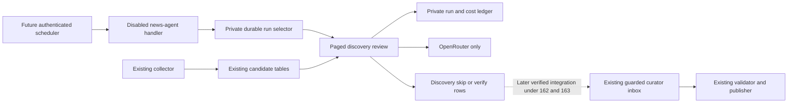

# Disabled Warp Core producer

This is the implementation path for #161 within PR #166. It is disabled and
nonpublishing. It has not run on hosted Supabase or against an actual model.
Issue #161 remains open until its full acceptance evidence is recorded.

## Runtime decision

Use the native Deno Edge Function request handler and a small explicit durable
state machine, with fixed PostgREST RPCs as the database adapter. This builds on
the repository's existing function pattern without adding an agent framework or
another queue vendor. The model only returns discovery decisions. It cannot
choose tools, destinations, settings, budgets or publication authority. This is
an implementation decision; hosted compatibility and model quality still require
the #160/#164 evidence campaign.

The current collector, dot curator, publisher and schedules are unchanged.
`index.ts` hardcodes `enabled:false`. `supabase/config.toml` requires platform JWT
verification; the handler additionally requires a distinct
`x-warpcore-agent-token`, backed by `WARPCORE_AGENT_CRON_TOKEN`. The request body
must be empty or `{}`. It cannot select a run, model or budget. Service construction
is lazy and occurs only after authentication and enablement.

## Durable review

Normalized candidate and decision rows eliminate the legacy aggregate 2MB JSON
checkpoint ceiling. A run checkpoint stores identity, fixed cutoff, policy,
revision, phase, exact cursor, counts and at most 100 active IDs. Every page is
persisted before another invocation proceeds. Only an empty terminal page opens
review; review completion accounts for every captured candidate.

A read-only bounded preview lets the runtime fit the exact serialized HTTP body
under 200KB before freezing a batch. A requested item count is a maximum per
invocation, never a total review quota. An individual candidate that cannot fit
defers without dispatch or truncation. The operator must repair the input or
explicitly revise its representation; it is never silently counted as reviewed.

Leases and revisions fence atomic page/batch operations. SQL validation includes a
final lease check so expired transactions roll back their row inserts. The
remaining-time guard starts before claim and checks before reservation, dispatch
and HTTP. No lease renewal is claimed.

Only a database-confirmed budget denial with no attempt at the checkpoint can
reopen a batch as deferred. Unknown reserve/dispatch responses remain uncertain.
429/5xx, malformed results and timeouts do not automatically replay. Known costs
are settled even if editorial parsing fails; unknown costs retain reservations.
Success requires an immutable settlement audit containing model/generation
identity, token usage and exact cost. Known-error audits preserve available usage;
unknown-error audits contain sanitized codes. Run configuration is immutable and
excludes credentials, prompts and response bodies.

The selector is disabled in its own administrator-owned settings row. Once
separately authorized/configured, it serializes one new run per UTC hour, resumes
an incomplete run across invocations, and holds while reviewing/uncertain work
needs reconciliation. Selection does not claim a lease: competing triggers still
have to win the fenced claim. Workers cannot create/raise daily budgets or edit
settings. The selector never creates filler publication records.

## Installation and activation boundary

All SQL stays outside `supabase/migrations`; normal migrations cannot install it.
The proposed installation order is `shadow-state.sql`, `shadow-paged.sql`,
`shadow-audit.sql`, then `shadow-producer.sql`. The latter adds narrow,
service-role-only RPCs in `public`; internal tables/helpers remain private with
RLS and revoked direct worker access. There is no generic SQL endpoint.

No schedule is installed. A future approved pg_cron/pg_net schedule can invoke the
producer once per minute to continue bounded work, using Vault-held gateway and
dedicated producer credentials. It must leave all existing collector/curator/
publisher schedules untouched. The selector, rather than the scheduler's request
body, fixes run identity and cutoff. An active invocation's lease naturally
prevents a second trigger from advancing it concurrently.

Before any hosted spike, review exact deployed bundles/schema/configuration and
the installed SQL/RPC grants. Provision the dedicated producer token, server-side
OpenRouter key and immutable model configuration only with explicit authorization.
Required server settings are `SUPABASE_URL`, `SUPABASE_SERVICE_ROLE_KEY`,
`WARPCORE_AGENT_CRON_TOKEN`, `OPENROUTER_API_KEY`, `WARPCORE_AGENT_MODEL`,
`WARPCORE_AGENT_MAX_OUTPUT_TOKENS` and `WARPCORE_AGENT_MAX_COST_CREDITS`.
There is no default model or spending limit. OpenRouter credits are not assumed
USD; verified worst-case pricing, routing, currency conversion and per-run/day
ceilings must be approved before enabling paid transport. Runtime model config
must match across resumed invocations; changing it requires operator review.

## Evidence and unmet acceptance

Local unit/embedded tests use synthetic inputs and fabricated HTTP only. The
integration composition reviews 405 same-source candidates totaling over2MB,
including a final-page `verify` decision, through invocation restarts. Tests also
cover empty scans, exact HTTP hashes, deferral, uncertainty, immutable audits,
lease rollback and permissions. CI additionally exercises actual independent
PostgreSQL sessions and PostgREST. Deno type checking covers the inactive entrypoint.

These checks do not demonstrate factual verification, relevance, global ranking,
semantic deduplication, native repost identity or rendered Bluesky output. There
is no submission path from this producer, so it cannot bypass or prove the
existing five-item/five-attempt guards; #163 owns that integration. Hosted
unattended operation, actual model/provider/pricing validation and approved
scheduled continuation remain unrun. Do not close #161, #160 or #159 based on
this disabled foundation. Production cutover and test-account posting retain
their separate approval gates.
