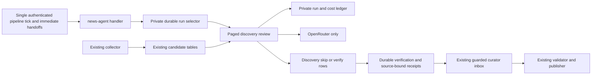

# Warp Core autonomous producer

The producer is part of the active pipeline according to the November 17–19 deployment evidence in the [architecture reference](architecture.md). This is not a current live-state assertion. Earlier disabled-foundation and pilot evidence does not describe current deployment. [Inventory and recovery](warpcore-recovery.md) defines operational boundaries.

## Runtime decision

Use the native Deno Edge Function request handler and a small explicit durable
state machine, with fixed PostgREST RPCs as the database adapter. This builds on
the repository's existing function pattern without adding an agent framework or
another queue vendor. The model only returns discovery decisions. It cannot
choose tools, destinations, settings, budgets or publication authority. This is
an implementation decision; hosted compatibility and model quality still require
the #160/#164 evidence campaign.

The agent is the intended sole new editorial producer; the curation drain and guarded publisher remain distinct workers. Current pipeline dispatch replaces the older independent stage schedules.
`supabase/config.toml` requires platform JWT verification. Existing deployments
with `WARPCORE_AGENT_CRON_TOKEN` retain the explicit `WARPCORE_AGENT_ENABLED=true`
environment gate and dedicated `x-warpcore-agent-token` check. When that token is
absent, `index.ts` uses protected database bootstrap: `producer_settings.enabled`
defaults false, and disabled requests return before runtime secret lookup. The
service-role-only authorization RPC supplies the dedicated token to trusted server
code; runtime configuration and the OpenRouter key are read only after that token
is authenticated. The request body must be empty or `{}` and cannot select a run,
model, source host, credential or budget. Hosted discovery uses batches of 16,
4096 output tokens and optional fenced lease release between committed invocations;
these bounds do not authorize paid transport before configuration and budget pinning.

## Durable review

Normalized candidate and decision rows eliminate the legacy aggregate 2MB JSON
checkpoint ceiling. A run checkpoint stores identity, fixed cutoff, policy,
revision, phase, exact cursor, counts and at most 100 active IDs. Every page is
persisted before another invocation proceeds. The current waiting-list selector takes eligible items directly into bounded review; legacy paged scans retain their resumable cursor. Review completion accounts for every captured candidate, while committed qualifying items may proceed to verification before remaining feed review completes.

A read-only bounded preview lets the runtime fit the exact serialized HTTP body
under 200KB before freezing a batch. A requested item count is a maximum per
invocation, never a total review quota. An individual candidate that cannot fit
defers without dispatch or truncation. The operator must repair the input or
explicitly revise its representation; it is never silently counted as reviewed.

Leases and revisions fence atomic page/batch operations. SQL validation includes a
final lease check so expired transactions roll back their row inserts. The
remaining-time guard starts before claim and checks before reservation, dispatch
and HTTP. No lease renewal is claimed.

Only a database-confirmed budget denial with no attempt at the checkpoint can
reopen a batch as deferred. Unknown reserve/dispatch responses remain uncertain.
429/5xx, malformed results and timeouts do not automatically replay. Known costs
are settled even if editorial parsing fails; unknown costs retain reservations.
Success requires an immutable settlement audit containing model/generation
identity, token usage and exact cost. Known-error audits preserve available usage;
unknown-error audits contain sanitized codes. Run configuration is immutable and
excludes credentials, prompts and response bodies.

The selector defaults disabled in its administrator-owned settings row. When enabled, it serializes waiting-list selection, resumes incomplete work across invocations, and holds while reviewing/uncertain work needs reconciliation. New batches are not limited to one run per UTC hour. Selection does not claim a lease: competing triggers still
have to win the fenced claim. Workers cannot create/raise daily budgets or edit
settings. The selector never creates filler publication records.

## Installation and activation boundary

SQL files under `supabase/functions/news-agent/sql` are contracts/reference installers, with later dated migrations under `supabase/migrations`. Neither applying every historical file nor deploying the tracked safety-locked entrypoints reproduces the approved hosted bundle. Inventory installed definitions and deployed artifacts first. The following continuation installer describes the historical disabled foundation; do not install it alongside the current pipeline job.

The separate administrator-only `supabase/schedules/install-agent-disabled.sql`
installer requires reviewed pg_cron, pg_net and Vault extensions plus installed
shadow ranking/producer contracts. It refuses duplicate installation and unsafe
effective anonymous/authenticated Vault access and cron administration by
anonymous, authenticated or service roles. Managed Supabase grants Vault access
to `service_role` and function EXECUTE on `cron.schedule` to PUBLIC. The installer
preserves those vendor ACLs and checks schema USAGE together with object
privileges; EXECUTE alone does not grant access to the cron schema. The service
role is trusted server infrastructure, never an unprivileged model worker.
Neither model prompts nor anonymous/authenticated callers receive decrypted secrets. See the
[Supabase privilege guidance](https://supabase.com/kb/troubleshooting/revoking-privileges-on-storage-pg_cron-vault-and-extension-objects-has-no-effect-916576). In one transaction it creates
`warpcore-news-agent-continuation` (`* * * * *`) and sets it inactive through `cron.alter_job`, verifying that exact job ID. It queues no
HTTP during installation and never changes existing jobs or provisions budgets.

The private enqueue helper returns without HTTP while the database producer is
disabled. Protected `shadow_agent.scheduler_settings.approved_project_origin`
starts NULL and requires an administrator-reviewed canonical
`https://<project-ref>.supabase.co` origin. Runtime Vault names are
`warpcore_agent_project_url`, `warpcore_agent_gateway_anon_jwt` and
`warpcore_agent_cron_token`. Each must resolve exactly once; credentials must be
32..4096 characters without whitespace and distinct. The runtime origin must
exactly equal the protected pin. Requests always target `/functions/v1/news-agent`,
send `{}`, Bearer gateway authorization and `x-warpcore-agent-token`, with a
120000ms HTTP timeout. Request data cannot select configuration. Worker roles
cannot call the helper or read/write scheduler settings.

Cron active status and database producer enablement are independent activation
controls. The legacy environment route additionally retains its explicit flag.
Installers leave continuation scheduling and database production disabled.
The selector fixes run identity/cutoff; leases fence competing continuations.

Before any hosted spike, review exact deployed bundles/schema/configuration and
the installed SQL/RPC grants. Provision the dedicated producer token, server-side
OpenRouter key and immutable model configuration only with explicit authorization.
Hosted bootstrap requires the existing `SUPABASE_URL` and
`SUPABASE_SERVICE_ROLE_KEY`, installed `runtime-bootstrap.sql`, pinned
`runtime_settings.allowed_source_hosts`, and private Vault entries
`warpcore_agent_cron_token` and `warpcore_agent_openrouter_key`. The database
producer gate must remain off until reviewed activation. The legacy environment
route instead uses `WARPCORE_AGENT_ENABLED`, `WARPCORE_AGENT_CRON_TOKEN`,
`OPENROUTER_API_KEY`, `WARPCORE_AGENT_MODEL`, `WARPCORE_AGENT_MAX_OUTPUT_TOKENS`
and `WARPCORE_AGENT_MAX_COST_CREDITS`.
The original hosted bootstrap pinned GPT-oss/Groq and a conservative per-attempt ceiling; later model/provider selections are dated in the architecture reference.
standing run/day budgets must be provisioned separately. OpenRouter credits are not assumed
USD; verified worst-case pricing, routing, currency conversion and per-run/day
ceilings must be approved before enabling paid transport. Runtime model config
must match across resumed invocations; changing it requires operator review.

## Evidence and unmet acceptance

Local unit/embedded tests use synthetic inputs and fabricated HTTP only. The
integration composition reviews 405 same-source candidates totaling over2MB,
including a final-page `verify` decision, through invocation restarts. Tests also
cover empty scans, exact HTTP hashes, deferral, uncertainty, immutable audits,
lease rollback and permissions. CI additionally exercises actual independent
PostgreSQL sessions and PostgREST. Deno type checking covers the inactive entrypoint.

These synthetic checks do not establish editorial quality or current hosted health. Later integration added submission through guarded verification receipts and shared five-item pending capacity. The historical five-attempt/hour bound was removed by migration `20261118180116_warpcore_drain_without_hourly_quota.sql`; attempt counters and uncertain outcomes remain. Hosted first-publication evidence is dated in the architecture reference, and no reliability deployment or production rollback was performed by the November 21 local work.

The single recurring pipeline tick is distinct from immediate database dispatch: collection completion wakes item processing, inbox admission wakes curation, and approved prepared records wake publication. Tick recovery retains existing queue identities. Disabling the job alone does not disable those event paths; the shared producer gate also fences `pipeline_enqueue`. Disabling any gate does not cancel HTTP already queued or running. See the recovery reference before stopping or resuming.
