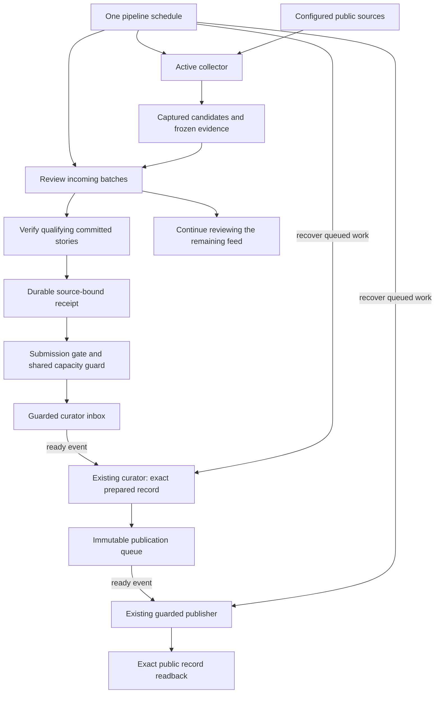

# Warp Core architecture and operational status

Warp Core collects public news into the existing Supabase News Digest project and publishes through a guarded Bluesky queue. The Gemma-backed autonomous agent is the enabled editorial producer, and its first ordinary post and native repost have been published through the existing guarded sender. The owner explicitly approved shipping. The old Dot task is off according to the owner; that task's retirement was not independently verified through a schedule-control tool.

This is the central current reference for Warp Core. The checkpoint below is an operator-reported deployment snapshot, not an automatically refreshed status page. Confirm live versions and flags before changing a deployment. Older documents retain useful contracts and evidence, but their deployment statements describe their recorded dates.

## Deployment checkpoint

| Area | Recorded state |
|---|---|
| Collector | Version 17, hourly at minute `:17`, active; 43 configured public sources |
| Source acquisition health | Earlier recorded two-hour window: all 43 sources attempted; 37 historical gaps, five partial traversals and one Perplexity HTTP 403 failure; these are distinct outcomes, not 43 collection outages |
| Curation drain | Version 6, dispatched when an agent inbox row arrives, with single-tick recovery as the receipt-aware database drain; retained legacy inbox work is not deleted |
| Publisher | Version 12, dispatched when an approved record is prepared, with single-tick recovery with its existing account, queue and guards |
| Autonomous producer | `news-agent` version 23, using Gemma 4 26B / PrimeIntellect and verification V8, with a 60-second model deadline and 180-second lease; producer, verification, submission and 30-minute pipeline schedule enabled. Reviewed shared-pool 429 continuation is installed; generic unknown failures still require owner recovery |
| Retained discovery evidence | Two Together discovery cycles completed 650/650 and 651/651 assessments for 0.06916930 and 0.06925995 credits. A cloud-scheduled Cerebras cycle also completed 652/652 for 0.17891190 credits. Earlier unknown holds remain preserved; full coverage does not establish editorial quality |
| Earlier Gemma discovery cycle | Run `755c7c94-ca0b-4e58-8d71-c98e46bcf6f7` failed on timeout after 64/654 assessments, revision 18; 0.0060952 spent and 0.036045 unknown held. Owner-CAS workflow quarantine advanced it to revision 19, deferred/blocked, without releasing money. No complete Gemma scan is claimed |
| Active model contract | `google/gemma-4-26b-a4b-it`, pinned `primeintellect/bf16`, discovery profile `2026-11-17.8`, no provider fallback, ZDR and reasoning `none`; 4096 output tokens and a 0.036045-credit reservation. Future active selection is restricted to GPT-oss or Gemma; NVIDIA/Meta history remains retained for accounting |
| Verification and admission | Receipt, verification-job and shared five-item guards installed; verification, backfill and submission enabled. `exclusive_agent=true` fences new Dot submissions; existing jobs, queues and financial history remain intact |
| First published results | Publisher request 842 returned HTTP 200 with two processed records, both `published`: a 240-character GLM post and a Verano native repost. Exact ordinary AppView/UI and native public-PDS readback evidence is recorded in the [cutover report](evidence/2026-11-17-scheduled-discovery-quality.md#gemma-cutover-and-first-publications) |
| Legacy Dot schedule | Owner-confirmed off; exact legacy automation control was unavailable to this operator. This is distinct from the still-needed curation drain |
| Spending policy | Private ledger and existing prepaid OpenRouter credits; recorded limits are 2 credits per UTC day and 19.99 credits lifetime |
| Exception alerts | Dashboard backend enabled by the operator; authenticated RPC verified. Signed-in frontend delivery remains unverified; no owner channel selection is claimed |
| Public owner feedback | SQL and full runtime deployed, disabled. Halo public-API check returned an explicit empty-feed coverage gap |

Earlier incomplete discovery and unknown-billing attempts remain preserved in the audit ledger. The current keyed schema requires every supplied candidate ID before ranking. A later unbilled follow-on scan was explicitly cancelled with its captured candidates retained; it was not relabeled as completed. See the [scheduled discovery and quality checkpoint](evidence/2026-11-17-scheduled-discovery-quality.md).

These are OpenRouter credit limits and measured credit charges, not a claim of free inference or a currency conversion. No additional paid service is introduced. Keys remain private in server configuration or Vault and are not stored in GitHub.

## What runs where

| System | Responsibility |
|---|---|
| Supabase Edge Functions | Existing public-source collection, curator processing and publishing; autonomous discovery and verification |
| PostgreSQL, pg_cron, pg_net and Vault | Durable evidence and queues, leases, budgets, authenticated scheduled requests and private server credentials |
| OpenRouter, explicit reviewed model/provider registry | Bounded model judgments about discovery and evidence, with explicit provider/privacy/price controls and no fallback |
| Strix Halo | Disposable PostgreSQL/PostgREST/Deno tests and bounded model checks; it is not a production dependency of the Supabase pipeline |
| GAIA and Lemonade | Earlier Python/local-inference digest path; not the active Warp Core publishing runtime |
| Web reader and TTS | Separate digest-reading application; this producer transition does not change its authentication, playback or deployment |

The reader is documented in [web/README.md](../web/README.md). The older [GAIA/Lemonade architecture](architecture.md) describes the local digest design. Its scheduler and systemd deployment instructions should not be used to infer which Warp Core workers are active.

## News flow and authority

The agent is the sole enabled new editorial producer at this checkpoint. Owner-reported Dot task retirement and the database exclusivity fence are separate controls. A ranking proposal is not verified news, a verification receipt is not a publication, and an inbox ID is not public-readback evidence.

1. **Collection:** the configured roster supplies public discovery material. Each source has durable attempt/checkpoint state. A fresh successful retrieval can still have a historical coverage gap; a `gap` is not automatically an outage or proof of complete upstream history. See [source acquisition checkpoints](warpcore-source-checkpoints.md).
2. **Discovery:** one fixed scan timestamp and a keyset cursor cover every eligible candidate. Bounded pages and batches control each invocation, not total review coverage. Committed assessments survive restart. Qualifying committed decisions can enter verification before the full review finishes. One early verification per committed batch interleaves with continued review, so posting and coverage both make progress. Completion validates full coverage and records counts; it performs no global sort or new final-shortlist writes. There is no separate five-stories-per-parent-run ceiling; the shared pending queue and account/hour publication-attempt bound remain five.
3. **Verification:** exact captured URLs or a fixed public Bluesky API route provide bounded public evidence. DNS/IP-pinned TLS retrieval rejects private destinations and redirects. Source text and model output remain untrusted. Trusted code binds hashes, exact quotations, original identities and dates; whether a quotation supports a natural-language claim remains an explicitly recorded model judgment.
4. **Preview and receipt:** current evidence and complete publication/pending-work history bind a durable receipt. Verification can finish while submission remains disabled for owner review. Stale evidence, changed history or expired receipts prevent transfer.
5. **Admission and curation:** a distinct agent identity enters the existing guarded inbox only through the submission gate. It does not impersonate a Dot. The shared admission boundary keeps combined pending editorial/publication work within five distinct stories, including legacy writers. The curator reconstructs and checks the exact frozen packet and publication job.
6. **Publication:** the publisher uses the stored account, collection, immutable TID record key and payload. It consumes an atomic hourly attempt slot before a write; unknown outcomes count toward the five-attempt limit. For native reposts, `verifySubject` re-fetches the public original and checks its URI, CID and author immediately before writing. A write receipt alone is insufficient: reconciliation reads back the exact record and URI. Mismatch or uncertainty requires reconciliation, never automatic re-keying or a blind repeat write.

Original summaries use non-Bluesky primary evidence and retain attribution. Captured Bluesky originals can produce only a native repost of the exact subject, preserving the original author. The native verification path does not authorize copied summaries of those posts. See [native repost contracts and dated deployment evidence](warpcore-native-reposts.md).

## Gates, spending and operational visibility

The database producer setting, cron active flag, verification setting and submission setting are separate controls. Keeping verification or submission off must not require disabling the existing collector or publisher.

The hosted bootstrap uses the existing Supabase project URL and trusted server service-role key. With no legacy `WARPCORE_AGENT_CRON_TOKEN` environment setting, the protected database producer gate defaults off. Service-only fixed RPCs supply private authorization/runtime values to server code; the dedicated trigger token is checked before model-key lookup and work. Existing environment-token installations retain their explicit environment gate. Platform JWT verification remains required. The request body cannot choose a model, budget, source, destination or run.

The service role is trusted server infrastructure, not a model worker. Managed Supabase already gives it Vault privileges. Private tables and administrative helpers retain their own grants; anonymous/authenticated callers and the model receive neither credentials nor arbitrary SQL authority. See [producer implementation details](warpcore-agent-producer.md) for the fixed RPC and scheduler contracts.

Every paid request requires a pre-existing ledger reservation and a recorded dispatch. Known usage settles before content validation; an invalid completion does not erase its cost. Unknown usage retains a conservative hold and prevents automatic paid replay. Daily provisioning respects lifetime headroom and never raises or resets an existing budget. The active Gemma row retains a 16-candidate discovery batch, 4096 output tokens and its model-specific reservation. GPT-oss/Cerebras remains an allowed alternative with its existing limits; retired NVIDIA/Meta profiles remain accounting history, not future active selections. The producer is enabled. Exact Gemma/PrimeIntellect shared-pool 429 failures can be audited and excluded from future work after at least five minutes beyond lease expiry, respecting longer Retry-After and a ten-per-UTC-day bound; their unknown reservations remain held and failed requests cannot replay. Generic unknown failures still stop verification for owner recovery. Optional fenced release of a successfully committed lease lets the next invocation continue promptly without changing coverage or paid-attempt history.

`warpcore_agent_health()` exposes safe operational aggregates. Source health should be compared against the exact configured 43-source key set using `warpcore_source_sync_health`; the older digest reader's source-health view is a separate dataset. Report recent attempts, partial progress, historical gaps and failures separately.

Prepared dashboard alerts emit fixed exception codes and aggregate counts, with transition deduplication and optional resolution messages. They distinguish actual stalled progress from lease renewal, recent historical gaps from source-attempt outages, and an owner-waiting preview from an enabled but stalled handoff. This is a delivery option, not an owner-approved alert destination. Enabling it or replacing a cron command is an explicit operational change; installation alone performs neither.

## Public owner feedback

The prepared feedback path reads a fixed public author-feed endpoint for the pinned owner DID and verifies replies to Warp Core's public post identities. It records bounded, inert feedback for operator review. It cannot edit editorial policy, spending, credentials or schedules, initiate a Dot chat, read private messages or answer publicly. The Halo empty-feed result is a coverage gap, not proof of complete historical feedback retrieval. See [public owner feedback](warpcore-owner-feedback.md) for its identity, pagination and review boundaries.

## Cutover and continuing validation

The owner explicitly said “Ship it” for the Gemma rollout. Producer, verification, submission, exclusivity and the minute continuation cron were enabled. Publisher request 842 processed two records and reported both published. The GLM ordinary post has public AppView and read-only UI confirmation; the native repost has authoritative public PDS readback of its exact URI, CID and original subject. See the [publication evidence](evidence/2026-11-17-scheduled-discovery-quality.md#gemma-cutover-and-first-publications).

This is a recorded cutover and first-publication result, not a numeric editorial-quality score or proof of sustained unattended reliability. The earlier [editorial review packet](evidence/2026-11-17-editorial-review.md) remains historical: its held llama.cpp preview must not be submitted, and earlier model/source failures are not relabeled as passes. Shipping the current Gemma results does not approve those held records.

Continue observing full discovery coverage, source retrieval and quote support, duplicate handling, actual rendered text and native attribution, spending/holds, overlap and uncertain-write reconciliation. A model judgment is not a deterministic entailment proof. GitHub V6-and-later release-body/date quote roles are enforced in trusted canonical runtime code; SQL still proves raw hashes, spans, source identity and date bindings.

Use exact deployed targets and read back flags before further operational changes. Keep collector, curation drain and collection-aware publisher available. Do not confuse an owner-confirmed disabled Dot task with a tool-verified automation retirement, or the exclusivity fence with stopping Dot reasoning costs.

The reviewed timeout and exact shared-pool 429 workflow controls are installed. The failed 64/654 discovery cycle remains incomplete: an explicit owner-CAS quarantine moved revision 18 to 19, deferred/blocked, preserving its unknown hold. One eligible verification 429 was advanced. Readback found zero blocking discovery runs and zero unquarantined uncertain verifier jobs, and producer, verification, submission and minute cron were restored. All eight unknown attempts and the whole budget were exactly unchanged: 0.625054 held and 0.6044672 spent credits. This releases workflow fences, not billing uncertainty or failed-request replay. Generic unknown failures still require owner recovery; the discovery timeout helper is private and manual. Neither enabled scheduling nor two publications establishes full Gemma coverage or sustained reliability. Source capture remains full or deferred, never truncated: Gemma's aggregate bound is 200000 bytes, GPT-oss/Cerebras 120000, and each GitHub release API capture at most 100000. These byte bounds do not guarantee a provider token-context fit.

Every new record remains subject to public-source/native identity, freshness, complete-history deduplication, attribution, shared pending capacity and the hard 300-grapheme/3000-byte publication checks. Minor prose imperfections accepted by the owner do not bypass these deterministic guards. No new per-story owner approval screen is introduced.

## Stop and rollback

1. Pause the autonomous continuation cron and disable the database producer gate to stop new discovery/model dispatch. Disable verification and submission as needed. A flag change does not cancel an already dispatched request; inspect its durable outcome before taking another action.
2. Keep all run checkpoints, candidate assessments, reservations, settled usage, uncertain holds, receipts, inbox rows, publication jobs and record keys. Do not reset a budget or delete history to resume work.
3. Reconcile any sending/uncertain publication by its original account, collection and TID. Keep the collection-aware publisher available for reconciliation. If new publication sends must stop, use its enable flag while preserving the stored queue and reconciliation capability; never swap in an older post-only publisher while reposts remain unresolved.
4. Before restoring new Dot submissions, use the same shared cutover boundary to clear agent exclusivity and confirm the agent submission gate is off. Resume only the intended single editorial producer. Do not alter collector coverage or pending queues as part of that switch.
5. Verify live gates and cron state, then record the incident and retained work. Alert and feedback settings remain independent; their availability does not grant publication authority.

## Evidence and further references

- [Editorial policy](../supabase/functions/news-agent/policy.mjs): current scope, verification, attribution, full coverage and native-repost rules.
- [Ranking acceptance checkpoint, November 16](evidence/2026-11-16-ranking-acceptance.md): 405-candidate synthetic ordering/restart checks and their limitations.
- [Paid pilot receipt, November 16](evidence/2026-11-16-strix-halo-paid/result.json): recorded model/provider costs and development-label agreement; not held-out or live publication acceptance.
- [Hosted spike history](warpcore-hosted-spike.md): dated environment attempts and test boundaries, not the current deployment map.
- [Full-review contract](warpcore-full-review.md), [shared publication budgets](warpcore-hourly-batches.md) and [source directory](warpcore-sources.md): detailed existing operational contracts; recheck dated deployment statements against the checkpoint above.
- [Reader documentation](../web/README.md) and [earlier local digest architecture](architecture.md): separate reading/local-inference paths.

## Discovery timeout follow-up

Repeated 30-second Gemma discovery timeouts were an operational defect, not an editorial-quality failure. The follow-up raises the bounded model deadline to 60 seconds with a 180-second lease and adds narrowly scoped automatic quarantine for exact recorded Gemma discovery timeouts and strictly identified PrimeIntellect shared-pool 429s after lease expiry plus five minutes, capped at ten combined recoveries per UTC day; a longer bounded Retry-After is respected. Full unknown holds and failed coverage remain recorded, and old workflows cannot replay. Later scans use the normal UTC-hour slots. See the [bounded timeout recovery evidence](evidence/2026-11-17-gemma-timeout-recovery.md). Source/history deadlines and publication guards remain intact.

The receipt-aware curation drain now runs every minute (same existing job and v6 code), because the earlier hourly wait allowed three guarded receipts to become stale. Those three inbox records were safely rejected and retained, not counted as publications. That earlier checkpoint is superseded by the rolling event-driven handoff below; account and send guards remain.

## Rolling publication

The owner replaced the batch-first publication requirement with find, verify and publish. Up to ten existing capture pages run in one bounded invocation; larger scans still resume with their keyset cursor. Already committed eligible decisions can be verified while remaining candidates continue through review. A full queue yields to background review instead of paying for more verification.

One recurring pipeline tick replaces the separate collector, agent, curator and publisher schedules. Durable inbox/approval events dispatch the next existing worker immediately, and the tick recovers queued work. The guarded publisher reads its actual pending queue before reserving a login. Empty checks use no login attempt. Its self-imposed authentication budget is five atomic attempts per account/UTC hour, including failed attempts; existing used slots are preserved. The independent five-publication-attempt/hour limit, immutable records, pinned identity and uncertain-write readback are unchanged. No session cache or new credential store is introduced.

Historical ranking rows are retained; the obsolete end-of-scan sort and shortlist creation are removed. Published stories qualify as they are reviewed rather than competing for a final best-five batch. Every candidate still receives review, and source, history, freshness, duplicate, factual-attribution and spending gates remain in force. Collection remains on its existing source schedule; publication follows qualification rather than waiting for another fixed-hour batch.

### One schedule and immediate handoff

The single private pipeline tick enqueues normal hourly collection and bounded agent work, then recovers durable curator/publication queues when needed. A newly enqueued collection temporarily defers only allocation of a new fixed discovery scan; existing review and verification can proceed. Agent inbox rows dispatch the curator after commit; approved prepared records dispatch the publisher after commit. Fixed routes, existing Vault authentication, private helpers and minute/hour coalescing keep this dispatch narrow. Failed enqueue does not roll back a valid queue record; the next tick retries the existing guarded path. The old four stage schedules are removed at cutover.

## Fresh-start cutoff

At the owner's request, unpublished backlog is cleared and the existing single pipeline runs every 30 minutes. The private `first_seen_since` cutoff admits only canonical stories first collected after that reset. Refreshing evidence does not change a story's original collection time. Matching the verification cohort cutoff prevents old completed or quarantined discovery work from feeding the new queue. Previously published records, source history, model costs and unresolved holds remain intact.
