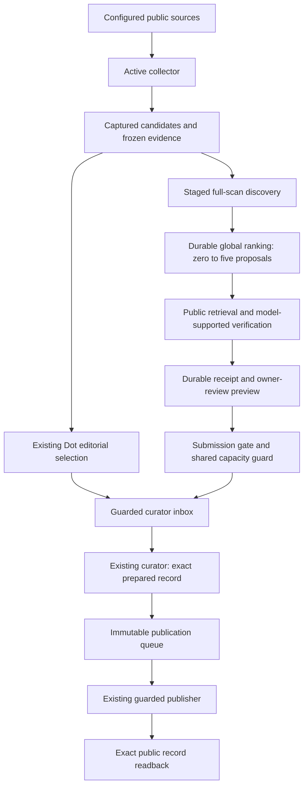

# Warp Core architecture and operational status

Warp Core collects public news into the existing Supabase News Digest project and publishes through a guarded Bluesky queue. The existing Dot-driven editorial pipeline remains active. An autonomous producer is being validated alongside it; its new code and installed SQL do not establish that production cutover or editorial acceptance has passed.

This is the central current reference for Warp Core. The checkpoint below is an operator-reported deployment snapshot, not an automatically refreshed status page. Confirm live versions and flags before changing a deployment. Older documents retain useful contracts and evidence, but their deployment statements describe their recorded dates.

## Deployment checkpoint

| Area | Recorded state |
|---|---|
| Collector | Version 17, hourly at minute `:17`, active; 43 configured public sources |
| Source acquisition health | All 43 sources attempted within the checkpoint’s two-hour window: 37 historical gaps, five partial traversals and one Perplexity HTTP 403 failure; these are distinct outcomes, not 43 collection outages |
| Existing curator | Version 6, hourly at `:23`, active with the existing Dot pipeline and receipt-aware agent adapter; authenticated empty-queue check passed |
| Publisher | Version 11, hourly at `:27`, active with its existing account, queue and guards |
| Autonomous producer | `news-agent` version 17 from `dbd0b7b`, with official GitHub release API capture and verification V5; GPT-oss / Cerebras profile `2026-11-17.6` selected after bounded verification comparisons. Producer, automatic submission and continuation cron are off; ordinary-post acceptance remains held |
| Paused discovery run | Two Together discovery cycles completed 650/650 and 651/651 assessments for 0.06916930 and 0.06925995 credits. A cloud-scheduled Cerebras cycle also completed 652/652 for 0.17891190 credits. Earlier unknown holds remain preserved; full coverage does not establish editorial quality |
| Replacement discovery contract | Active reviewed GPT-oss / Cerebras profile `2026-11-17.6`, coded keyed discovery schema v4, 8192 output ceiling and 0.076596-credit conservative reservation. Historical profiles remain immutable; the small paired diagnostic is not formal editorial acceptance |
| Verification and admission | Receipt, verification-job and shared five-item guard SQL installed; verification enabled, backfill enabled, `submit_enabled=false`; historical source-verified native receipts have expired; fresh verification and owner go/no-go remain required; no autonomous publication yet |
| Spending policy | Private ledger and existing prepaid OpenRouter credits; recorded limits are 2 credits per UTC day and 19.99 credits lifetime |
| Exception alerts | Dashboard backend enabled by the operator; authenticated RPC verified. Signed-in frontend delivery remains unverified; no owner channel selection is claimed |
| Public owner feedback | SQL and full runtime deployed, disabled. Halo public-API check returned an explicit empty-feed coverage gap |

Earlier incomplete discovery and unknown-billing attempts remain preserved in the audit ledger. The current keyed schema requires every supplied candidate ID before ranking. A later unbilled follow-on scan was explicitly cancelled with its captured candidates retained; it was not relabeled as completed. See the [scheduled discovery and quality checkpoint](evidence/2026-11-17-scheduled-discovery-quality.md).

These are OpenRouter credit limits and measured credit charges, not a claim of free inference or a currency conversion. No additional paid service is introduced. Keys remain private in server configuration or Vault and are not stored in GitHub.

## What runs where

| System | Responsibility |
|---|---|
| Supabase Edge Functions | Existing public-source collection, curator processing and publishing; staged autonomous discovery and verification |
| PostgreSQL, pg_cron, pg_net and Vault | Durable evidence and queues, leases, budgets, authenticated scheduled requests and private server credentials |
| OpenRouter, explicit reviewed model/provider registry | Bounded model judgments about discovery and evidence, with explicit provider/privacy/price controls and no fallback |
| Strix Halo | Disposable PostgreSQL/PostgREST/Deno tests and bounded model checks; it is not a production dependency of the Supabase pipeline |
| GAIA and Lemonade | Earlier Python/local-inference digest path; not the active Warp Core publishing runtime |
| Web reader and TTS | Separate digest-reading application; this producer transition does not change its authentication, playback or deployment |

The reader is documented in [web/README.md](../web/README.md). The older [GAIA/Lemonade architecture](architecture.md) describes the local digest design. Its scheduler and systemd deployment instructions should not be used to infer which Warp Core workers are active.

## News flow and authority

The staged route is gated independently from the active Dot route. A ranking proposal is not verified news, a verification receipt is not a publication, and an inbox ID is not public-readback evidence.

1. **Collection:** the configured roster supplies public discovery material. Each source has durable attempt/checkpoint state. A fresh successful retrieval can still have a historical coverage gap; a `gap` is not automatically an outage or proof of complete upstream history. See [source acquisition checkpoints](warpcore-source-checkpoints.md).
2. **Discovery:** one fixed scan timestamp and a keyset cursor cover every eligible candidate. Bounded pages and batches control each invocation, not total review coverage. Committed assessments survive restart. Global ordering happens only after complete coverage, using importance, relevance and a deterministic story-ID tie break.
3. **Verification:** exact captured URLs or a fixed public Bluesky API route provide bounded public evidence. DNS/IP-pinned TLS retrieval rejects private destinations and redirects. Source text and model output remain untrusted. Trusted code binds hashes, exact quotations, original identities and dates; whether a quotation supports a natural-language claim remains an explicitly recorded model judgment.
4. **Preview and receipt:** current evidence and complete publication/pending-work history bind a durable receipt. Verification can finish while submission remains disabled for owner review. Stale evidence, changed history or expired receipts prevent transfer.
5. **Admission and curation:** a distinct agent identity enters the existing guarded inbox only through the submission gate. It does not impersonate a Dot. The shared admission boundary keeps combined pending editorial/publication work within five distinct stories, including legacy writers. The curator reconstructs and checks the exact frozen packet and publication job.
6. **Publication:** the publisher uses the stored account, collection, immutable TID record key and payload. It consumes an atomic hourly attempt slot before a write; unknown outcomes count toward the five-attempt limit. For native reposts, `verifySubject` re-fetches the public original and checks its URI, CID and author immediately before writing. A write receipt alone is insufficient: reconciliation reads back the exact record and URI. Mismatch or uncertainty requires reconciliation, never automatic re-keying or a blind repeat write.

Original summaries use non-Bluesky primary evidence and retain attribution. Captured Bluesky originals can produce only a native repost of the exact subject, preserving the original author. The native verification path does not authorize copied summaries of those posts. See [native repost contracts and dated deployment evidence](warpcore-native-reposts.md).

## Gates, spending and operational visibility

The database producer setting, cron active flag, verification setting and submission setting are separate controls. Keeping verification or submission off must not require disabling the existing collector or publisher.

The hosted bootstrap uses the existing Supabase project URL and trusted server service-role key. With no legacy `WARPCORE_AGENT_CRON_TOKEN` environment setting, the protected database producer gate defaults off. Service-only fixed RPCs supply private authorization/runtime values to server code; the dedicated trigger token is checked before model-key lookup and work. Existing environment-token installations retain their explicit environment gate. Platform JWT verification remains required. The request body cannot choose a model, budget, source, destination or run.

The service role is trusted server infrastructure, not a model worker. Managed Supabase already gives it Vault privileges. Private tables and administrative helpers retain their own grants; anonymous/authenticated callers and the model receive neither credentials nor arbitrary SQL authority. See [producer implementation details](warpcore-agent-producer.md) for the fixed RPC and scheduler contracts.

Every paid request requires a pre-existing ledger reservation and a recorded dispatch. Known usage settles before content validation; an invalid completion does not erase its cost. Unknown usage retains a conservative hold and prevents automatic paid replay. Daily provisioning respects lifetime headroom and never raises or resets an existing budget. The active hosted Cerebras discovery bounds are 16 candidates per batch and 8192 output tokens; the retained NVIDIA profile uses 4096. Optional fenced release of a successfully committed lease lets the next invocation continue promptly without changing coverage or paid-attempt history.

`warpcore_agent_health()` exposes safe operational aggregates. Source health should be compared against the exact configured 43-source key set using `warpcore_source_sync_health`; the older digest reader's source-health view is a separate dataset. Report recent attempts, partial progress, historical gaps and failures separately.

Prepared dashboard alerts emit fixed exception codes and aggregate counts, with transition deduplication and optional resolution messages. They distinguish actual stalled progress from lease renewal, recent historical gaps from source-attempt outages, and an owner-waiting preview from an enabled but stalled handoff. This is a delivery option, not an owner-approved alert destination. Enabling it or replacing a cron command is an explicit operational change; installation alone performs neither.

## Public owner feedback

The prepared feedback path reads a fixed public author-feed endpoint for the pinned owner DID and verifies replies to Warp Core's public post identities. It records bounded, inert feedback for operator review. It cannot edit editorial policy, spending, credentials or schedules, initiate a Dot chat, read private messages or answer publicly. The Halo empty-feed result is a coverage gap, not proof of complete historical feedback retrieval. See [public owner feedback](warpcore-owner-feedback.md) for its identity, pagination and review boundaries.

## Activation checks and cutover

Use the existing reviewed deployment and admin tooling. Record exact targets and read back settings after each step; do not run historical installers blindly against the live project.

1. **Confirm the baseline.** Read the live function versions, bundle provenance, account, source roster, installed SQL, cron names/commands/owners and gate values. Preserve the active collector, curator and publisher. Confirm current budget spending, holds and queue contents before any new paid request.
2. **Validate the new discovery contract.** Deploy the reviewed keyed-schema bundle and matching SQL profile acceptance to the intended project. Keep verification and submission off. Use a fresh unbilled run/profile; do not rewrite the paused run, its 48 assessments or settled costs. Confirm complete review, global finalization and exact current-head provider/usage records before enabling scheduled continuation.
3. **Prepare evidence-backed previews.** Enable bounded verification with submission still off. Inspect source retrieval, original identity/date, quote support, complete-history deduplication and the entire rendered original post or native repost subject. Review selections and representative omissions with the owner. A schema-valid answer alone does not pass this gate.
4. **Exercise sending safely.** Confirm an available isolated test account and its exact public target for real rendering/readback acceptance; availability has not been established by the retained evidence. Confirm actual visible text/links or original-author attribution and exact stored/public record equality. Do not use synthetic test spam on the production account. No isolated-account or new autonomous public-readback acceptance is established by this checkpoint.
5. **Prove repeated operation.** Record multiple complete live cycles, truthful zero-selection/empty outcomes, resumes and overlap, with coverage, spend, queue capacity and reconciliation evidence. Historical synthetic tests are useful checks but do not replace this observation. Sample counts and editorial quality thresholds still need explicit owner review; the existing eight-case development corpus is not held-out acceptance.
6. **Choose and enable the producer.** Once the evidence gates pass, use the shared cutover boundary to make the agent the sole new editorial producer, enable its submission gate, and confirm the Dot no longer creates new submissions. Preserve existing pending work and the collection-aware publisher. Select the operational alert channel and enable only its reviewed delivery path. Do not remove the Dot fallback before independent operation is proven.

The implementation, new public-readback acceptance, owner-reviewed model quality and final cutover are separate milestones. This document does not declare the overall autonomous-agent goal complete.

A concrete [editorial review packet](evidence/2026-11-17-editorial-review.md) records the first real-news canary preview, independent primary-source review and representative omissions. Its owner decision is pending. Current pilot source capture is limited to 100,000 full raw bytes without truncation; meaningful larger pages may defer.

## Launch acceptance targets

Before submission is enabled, every proposed publication must have a supported current primary source or an exact native original, an in-window source date, complete-history duplicate review, all attribution links, and a prepared record within 300 graphemes and 3000 UTF-8 bytes. The reviewed sample set must contain zero unsupported factual assertions, lost material benchmark qualifications, already-published events, political exclusions or wrongly attributed originals. These are launch targets, not measured results.

Coverage requires every captured eligible candidate to receive one durable assessment before ranking, with no silent truncation. Review representative omissions alongside selections, including routine release candidates, old announcements, duplicate launches and material model/hardware changes. Record model judgment separately from deterministic source bindings. Two complete hosted discovery scans are recorded; current-model unattended operation, empty-cycle behavior and actual public display/readback remain separate acceptance evidence.

## Stop and rollback

1. Pause the autonomous continuation cron and disable the database producer gate to stop new discovery/model dispatch. Disable verification and submission as needed. A flag change does not cancel an already dispatched request; inspect its durable outcome before taking another action.
2. Keep all run checkpoints, candidate assessments, reservations, settled usage, uncertain holds, receipts, inbox rows, publication jobs and record keys. Do not reset a budget or delete history to resume work.
3. Reconcile any sending/uncertain publication by its original account, collection and TID. Keep the collection-aware publisher available for reconciliation. If new publication sends must stop, use its enable flag while preserving the stored queue and reconciliation capability; never swap in an older post-only publisher while reposts remain unresolved.
4. Before restoring new Dot submissions, use the same shared cutover boundary to clear agent exclusivity and confirm the agent submission gate is off. Resume only the intended single editorial producer. Do not alter collector coverage or pending queues as part of that switch.
5. Verify live gates and cron state, then record the incident and retained work. Alert and feedback settings remain independent; their availability does not grant publication authority.

## Evidence and further references

- [Editorial policy](../supabase/functions/news-agent/policy.mjs): current scope, verification, attribution, full coverage and native-repost rules.
- [Ranking acceptance checkpoint, November 16](evidence/2026-11-16-ranking-acceptance.md): 405-candidate synthetic ordering/restart checks and their limitations.
- [Paid pilot receipt, November 16](evidence/2026-11-16-strix-halo-paid/result.json): recorded model/provider costs and development-label agreement; not held-out or live publication acceptance.
- [Hosted spike history](warpcore-hosted-spike.md): dated environment attempts and test boundaries, not the current deployment map.
- [Full-review contract](warpcore-full-review.md), [shared publication budgets](warpcore-hourly-batches.md) and [source directory](warpcore-sources.md): detailed existing operational contracts; recheck dated deployment statements against the checkpoint above.
- [Reader documentation](../web/README.md) and [earlier local digest architecture](architecture.md): separate reading/local-inference paths.
